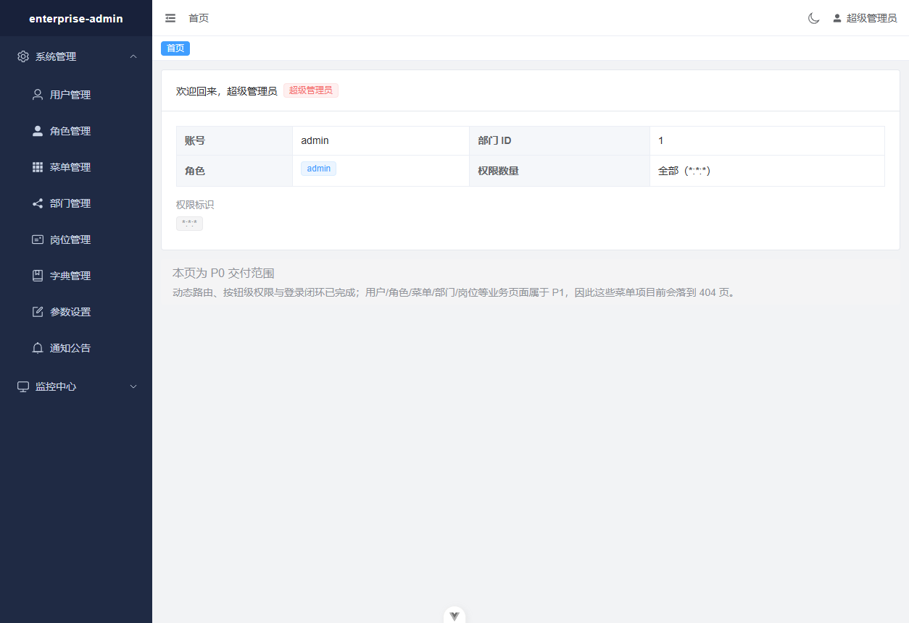

# enterprise-admin

企业级后台管理系统，前后端分离。后端 Python（FastAPI）提供 REST 接口，前端 Vue 3 + Element Plus
单页应用，数据落 MySQL 8。

当前进度：**P0（底座 + 登录垂直切片）已交付** —— 一键启动、登录闭环、四层权限模型中的接口级与
菜单/路由级已完成，动态菜单与按钮权限贯通前后端。业务页面（用户/角色/菜单/部门/岗位等）属于 P1。



---

## 一、技术栈

| 层 | 选型 | 版本 |
|---|---|---|
| 后端框架 | FastAPI | 0.143 |
| ORM / 迁移 | SQLAlchemy 2（async）+ Alembic | 2.1.5 / 1.20 |
| 数据库驱动 | asyncmy | 0.2.16 |
| 数据库 | MySQL（便携版，无需安装） | 8.0.29 |
| 认证 | PyJWT + bcrypt | 2.15 / 5.0 |
| 缓存 | 进程内 TTL 缓存（`CacheBackend` 可插拔） | — |
| 前端框架 | Vue 3 + TypeScript | 3.5 / 6.0 |
| 构建 | Vite | 8.3 |
| UI | Element Plus（按需自动导入） | 2.14 |
| 状态 / 路由 | Pinia / Vue Router | 4.1 / 5.4 |
| 测试 | pytest + httpx / Vitest | 9.1 / 4.1 |

版本由官方脚手架 `create-vue` 与 pip 解析后锁定（见 `backend/requirements.lock.txt`），
不靠记忆手写。

---

## 二、目录结构

```
enterprise-admin/
├─ backend/                  FastAPI 应用
│  ├─ app/
│  │  ├─ main.py             应用装配：中间件、异常、路由
│  │  ├─ core/               配置、安全、缓存、异常、鉴权依赖
│  │  ├─ db/                 引擎、会话、逻辑删除全局过滤
│  │  ├─ models/             ORM 模型（12 张表）
│  │  ├─ schemas/            Pydantic 出入参
│  │  ├─ services/           业务逻辑
│  │  ├─ api/v1/             路由层
│  │  └─ middlewares/        request-id
│  ├─ alembic/               迁移
│  ├─ scripts/seed_data.py   幂等种子数据
│  └─ tests/                 373 个测试
├─ frontend/                 Vue 3 应用
│  └─ src/
│     ├─ api/  stores/  router/  layout/  directives/  types/  utils/  views/
│     └─ utils/request.ts    axios 封装 + 单飞刷新
├─ tools/                    MySQL 便携版 下载 / 安装 / 启停
├─ init.ps1                  一次性：.env + 建库 + 迁移 + 种子数据
├─ start.ps1                 启动 MySQL + 后端 + 前端（支持 -Only 单独启动）
├─ stop.ps1                  停止（支持 -Only 单独停止）
├─ status.ps1                查看三个服务的状态（不启不停）
├─ db.ps1                    脱离后端单独管理数据库（状态/命令行/查询/备份/恢复）
└─ docs/                     设计文档、实施计划、架构与验收记录
```

---

## 三、环境要求

- Windows 10/11，PowerShell 5.1 及以上
- Python 3.12
- Node.js ≥ 24.12（前端 `engines` 要求；本项目在 24.14 上验证）
- 无需 Docker、无需预先安装 MySQL

**所有程序与数据默认落在 D 盘**（`tools/install-mysql.ps1` 与 `frontend/.npmrc` 已配置好），
不写入 C 盘用户目录。

---

## 四、首次安装

```powershell
# 1. 下载 MySQL 便携版（214MB，华为云镜像）
curl.exe -L -o tools\downloads\mysql-8.0.29-winx64.zip `
  https://mirrors.huaweicloud.com/mysql/Downloads/MySQL-8.0/mysql-8.0.29-winx64.zip

# 2. 解压并初始化数据目录（解压到 D:\devtools\mysql-8.0.29，数据在 D:\devtools\mysql-data）
powershell -ExecutionPolicy Bypass -File tools\install-mysql.ps1
powershell -ExecutionPolicy Bypass -File tools\mysql-ctl.ps1 -Action start

# 3. 设置 root 密码（只做一次）
& 'D:\devtools\mysql-8.0.29\bin\mysql.exe' --host=127.0.0.1 --port=3306 --user=root `
  --execute="ALTER USER 'root'@'localhost' IDENTIFIED BY 'Admin@123456';"

# 4. 后端虚拟环境与依赖
python -m venv backend\.venv
$env:PIP_CACHE_DIR='D:\devtools\caches\pip'
backend\.venv\Scripts\python.exe -m pip install -r backend\requirements.txt `
  -i https://pypi.tuna.tsinghua.edu.cn/simple

# 5. 前端依赖
cd frontend; npm install; cd ..
```

---

## 五、启动

```powershell
# 一次性：生成 .env（随机 SECRET_KEY）、建库、迁移、灌种子数据（幂等，可重复执行）
powershell -ExecutionPolicy Bypass -File init.ps1

# 启动 MySQL + 后端 + 前端
powershell -ExecutionPolicy Bypass -File start.ps1

# 停止
powershell -ExecutionPolicy Bypass -File stop.ps1
```

启动后：

| 入口 | 地址 |
|---|---|
| 前端界面 | http://127.0.0.1:5173 |
| 接口文档（Swagger） | http://127.0.0.1:8000/docs |
| 健康检查 | http://127.0.0.1:8000/health |

### 演示账号

| 账号 | 密码 | 角色 | 登录后可见 |
|---|---|---|---|
| `admin` | `Admin@123456` | 超级管理员 | 全部菜单，权限码 `*:*:*` |
| `manager` | `Manager@123` | 部门主管 | 用户管理 + 在线用户；数据权限生效，**只看到本部门的 2 行**（admin 能看到 4 行） |
| `staff` | `Staff@123` | 普通员工 | **无任何菜单** —— 侧边栏为空是预期行为 |
| `nobody` | `Nobody@123` | 无菜单角色 | 同上 |

`staff` 与 `nobody` 的空白侧边栏是刻意保留的：它是「无权限用户不应报错、不应白屏」这条要求的活体样本。

> 部署到任何真实环境前，请先改掉这些账号密码，并在 `.env` 中重新生成 `SECRET_KEY`。

### 分别启动 / 单个停止

三个服务可以完全独立启停。`-Only` 指的就是「**只动这一个，别的一律不碰**」。

```powershell
# 只起数据库（后端、前端都不动）
powershell -ExecutionPolicy Bypass -File start.ps1 -Only db

# 只起后端（不会去启动 MySQL —— 数据库停着它也能起来，首次查询时才报错）
powershell -ExecutionPolicy Bypass -File start.ps1 -Only backend

# 只起前端
powershell -ExecutionPolicy Bypass -File start.ps1 -Only frontend

# 只停一个
powershell -ExecutionPolicy Bypass -File stop.ps1 -Only backend
powershell -ExecutionPolicy Bypass -File stop.ps1 -Only frontend
powershell -ExecutionPolicy Bypass -File stop.ps1 -Only db
```

改端口同理：`start.ps1 -Only backend -BackendPort 8100`（记得同步 `frontend/vite.config.ts` 的代理目标）。

### 状态与日志

```powershell
# 三个服务的端口 / PID / /health / 数据库连通性，一行一个
powershell -ExecutionPolicy Bypass -File status.ps1

# 再顺带打印后端日志的最后 30 行（后端跑在独立窗口里，不用切过去看）
powershell -ExecutionPolicy Bypass -File status.ps1 -Logs
```

后端日志按天落在 `backend/logs/backend-YYYY-MM-DD.log`（保留 30 天）。

### 数据库单独管理（不经过后端）

```powershell
# 进程 / 端口 / 版本 / 表数量 / 库体积
powershell -ExecutionPolicy Bypass -File db.ps1

# 新窗口打开 mysql 交互命令行
powershell -ExecutionPolicy Bypass -File db.ps1 -Action console

# 跑一条查询（表格输出）
powershell -ExecutionPolicy Bypass -File db.ps1 -Action query -Sql "SELECT user_id, user_name FROM sys_user"

# 列出所有库 / 备份 / 恢复
powershell -ExecutionPolicy Bypass -File db.ps1 -Action databases
powershell -ExecutionPolicy Bypass -File db.ps1 -Action backup
powershell -ExecutionPolicy Bypass -File db.ps1 -Action restore -File D:\devtools\mysql-backups\enterprise_admin-20261022-110423.sql
```

备份落在 `D:\devtools\mysql-backups\`（`mysqldump --single-transaction`，不锁表，
备份期间后端照常读写）。

### 「单独重启数据库」会发生什么（已实测）

这是最容易踩坑的一步，所以实测过：

| 步骤 | 结果 |
|---|---|
| MySQL 运行中，带 token 请求 `/system/user` | `200`，4 行 |
| 只停 MySQL（`stop.ps1 -Only db`），同一 token 再请求 | **`503`「数据库暂时不可用，请稍后重试」** |
| 只起 MySQL（`start.ps1 -Only db`），**后端不重启**，同一 token 再请求 | `200`，4 行 —— **无需重新登录** |

原因是连接池开了 `pool_pre_ping=True`：每条连接出池前会先探活，死连接被丢弃重建。
所以数据库维护/重启**不需要重启后端**，用户也不会被踢出登录态。

> 数据库连不上时返回 `503` 而不是 `500`（写错的 SQL 仍是 `500`）：
> 前者是「稍后重试」，后者是「必须有人修」，两者的重试策略与告警完全不同。

---

## 六、常用命令

```powershell
# 后端测试（需要 MySQL 在跑；测试使用独立的 enterprise_admin_test 库，事务回滚）
cd backend; .venv\Scripts\python.exe -m pytest -q

# 前端测试 / 类型检查 / 代码检查 / 构建
cd frontend; npx vitest run
npm run type-check
npm run lint
npm run build

# 数据库迁移
cd backend
.venv\Scripts\python.exe -m alembic upgrade head                      # 开发库
.venv\Scripts\python.exe -m alembic -x db=enterprise_admin_test upgrade head
.venv\Scripts\python.exe -m alembic check                             # 迁移与模型是否有漂移

# 重新灌种子数据（幂等：已存在的记录不会被重复插入，展示字段会被刷新）
.venv\Scripts\python.exe -m scripts.seed_data
```

---

## 七、关键设计

### 四层权限

| 层 | 实现 | 位置 |
|---|---|---|
| 接口级 | `Depends(require_perm("system:user:add"))`，超管以 `*:*:*` 通配放行 | `backend/app/core/deps.py` |
| 菜单/路由级 | `GET /api/v1/auth/routers` 下发菜单树，前端 `addRoute` 动态注册 | `backend/app/services/menu_service.py`、`frontend/src/stores/permission.ts` |
| 按钮级 | `v-hasPerm="['system:user:add']"` 控制显隐 | `frontend/src/directives/hasPerm.ts` |
| 数据级 | 角色 `data_scope`（全部/自定义/本部门/本部门及以下/仅本人） | P1 |

**前端隐藏按钮只是体验优化，真正的拦截在后端接口级权限。** 两者读取同一份权限码，因此不会出现
「按钮藏了但接口能调」或反过来的错位。

### 令牌与会话

- access 30 分钟 + refresh 7 天，JWT HS256
- 令牌**落库**（`sys_user_token`）：这是「登出即刻失效」「强制下线」「在线用户」能成立的前提
- 前端 axios 封装做**单飞刷新**：三个并发请求同时 401 只触发一次刷新，不会把 refresh 令牌轮换三次
- 连续登录失败 5 次锁定 10 分钟

### 逻辑删除

`del_flag` 由一次性的全局 `do_orm_execute` 监听器统一过滤，任何会话都自动生效，业务代码无需手写
`WHERE del_flag='0'`。需要看已删数据时用 `include_deleted(session)` 显式逃生。

业务键（`user_name`、`role_key`）**故意不建数据库唯一索引**：否则逻辑删除后无法重建同名记录。

> **⚠️ 尚未闭环**：设计文档承诺的「唯一性由 service 层在事务内校验」**目前并不存在** —— P0 没有任何
> 创建接口，所以还没暴露出问题；P1 一旦加上用户/角色新增，就可能出现两条同名的活记录。这是 P1-A 的
> 必做项，已在 `docs/P0决策记录.md` 四.1 记录。

### 缓存

不引入 Redis。`CacheBackend` 抽象 + 进程内 TTL 实现（验证码、登录失败计数、字典缓存）。
切换 Redis 只需新增一个实现类并改 `app/core/cache.py` 最后一行。

代价要说清楚：进程内缓存是单进程的，多 worker 部署时每个 worker 各有一份。这就是该上 Redis 的临界点。

---

## 八、常见问题

**Q：`init.ps1` 报 `backend virtualenv not found`**
按第四节第 4 步创建虚拟环境。

**Q：MySQL 起不来 / `status` 报连不上**
看 `D:\devtools\mysql-logs\error.log`。常见原因是 3306 被占用：
`Get-NetTCPConnection -State Listen -LocalPort 3306`。

**Q：端口 8000 / 5173 被占用**
`start.ps1` 会检测并跳过已占用的端口。要改端口用 `-BackendPort` / `-FrontendPort`。

**Q：登录页不显示验证码**
后端 `.env` 里 `CAPTCHA_ENABLED=false`。这是有意的开关：验证码答案存在**服务端进程内存**里，
任何自动化客户端都读不到它，所以关掉它是端到端自动化测试唯一可行的路径。**对公网提供服务时必须保持
`true`。**

**Q：`DEBUG=true` 有什么风险？**
它会同时开启 `/docs`（接口文档）与一组**未鉴权**的 `/__test__/*` 调试路由，其中包含一个故意抛异常的
接口。演示环境无所谓，**对外暴露前必须把 `.env` 里的 `DEBUG` 改成 `false`** —— 改完 `/docs` 与那些
调试路由都会一并消失。

**Q：重启电脑后 `pytest` 全部报错 / 连不上数据库**
MySQL **没有**注册成 Windows 服务（有意为之：服务注册会写 C 盘注册表与 `C:\ProgramData`），
所以它不会随开机自启。测试套件现在会先探测连通性，直接用一句话提示你怎么办：

```
Cannot reach MySQL at 127.0.0.1:3306 ...
Start it with:
  powershell -ExecutionPolicy Bypass -File tools\mysql-ctl.ps1 -Action start
```

不想要这个手动步骤，可以自己把 `tools\install-*.ps1` 改成注册服务，或把 `start.ps1` 加进启动项。

**Q：为什么 `pytest` 必须连着 MySQL？**
测试跑在独立的 `enterprise_admin_test` 库上，每个用例一个事务并回滚，不会碰开发库。这是有意的：
拿 SQLite 测 MySQL 的行为等于没测。

**Q：登录成功后点菜单进了 404 页**
正常。P1 的业务页面尚未实现，`generateRoutes` 遇到找不到的组件会降级到 404 页并在控制台给出
`[permission] no view found for component "system/user/index"` 警告，而不是白屏。

**Q：PowerShell 里直接跑 `mysql.exe -h127.0.0.1` 报 `Unknown MySQL server host '127'`**
PowerShell 5.1 会把含点的紧凑短选项切开。用 `--host=127.0.0.1` 或 `-h 127.0.0.1`。

---

## 九、文档

| 文档 | 内容 |
|---|---|
| [面试讲解手册](docs/面试讲解手册.md) | **给这个项目配的讲述稿**：每个技术点按「一句话答案 / 30 秒 3–4 拍 / 仓库证据 / 追问短答」组织，含 30 秒与 2 分钟项目自述、高频追问 38 题、以及「我不知道／这是我接受的代价」的固定话术 |
| [架构设计](docs/架构设计.md) | 分层职责与请求生命周期、中间件顺序、异常体系、**四层权限逐层标注已实现/未实现**、令牌生命周期、逻辑删除全局过滤、缓存取舍；含登录与刷新的 Mermaid 时序/流程图 |
| [数据库设计](docs/数据库设计.md) | 11 张表的列/类型/索引/外键、ER 图、三组公共列的来源，以及为何 `user_name`/`role_key` 故意不建唯一索引、为何 `sys_menu` 没有 `del_flag` |
| [接口清单](docs/接口清单.md) | 第 3 节是 **P0 时期的历史快照**（当时 `/system/*` 全部不存在），顶部有横幅指向当前清单 |
| [设计文档](docs/superpowers/specs/2026-10-17-enterprise-admin-design.md) | 全景设计：架构、数据模型、四层权限、接口规范、分期计划、风险与取舍 |
| [P0 实施计划](docs/superpowers/plans/2026-10-17-p0-foundation-and-login.md) | P0 的 17 个任务与逐步验收方式 |
| [P1-A 实施计划](docs/superpowers/plans/2026-10-17-p1a-data-scope-and-rbac-crud.md) | 数据权限 + 组织与权限 CRUD（部门/岗位/菜单/角色/用户），即成功标准 S2 所需的最小完整切片 |
| [P1 验收记录](docs/P1验收记录.md) | 373 + 40 项测试的逐文件清单、**80 条接口的权威清单**、十四个页面的浏览器实测、S2 三角色对照与截图、以及未覆盖范围的逐条声明 |
| [P0 验收记录](docs/P0验收记录.md) | 测试清单与数量、S1 冷启动与浏览器验收证据、Review Focus 逐条覆盖、D 盘审计、独立评审与修复轮 |
| [P0 决策记录](docs/P0决策记录.md) | 全部实施裁定（决定 → 为什么 → 判断错误时的代价）+ 未修遗留问题清单 |
| [P1 决策记录](docs/P1决策记录.md) | P1-A 各任务的裁定（数据权限并集语义、失败关闭、自锁守卫等）+ 实施中发现的自身缺陷 |

> 三份技术文档都刻意区分「已实现」与「属于 P1」：本项目已经因为**文档夸大覆盖范围**被独立评审
> 纠正过一次，不想再来第二次。

---

## 十、已知取舍

- **MySQL 8.0.29 而非 8.4 LTS**：8.4 只在官方源提供，国内镜像不可达。功能上完全够用（utf8mb4、
  JSON、递归 CTE、窗口函数）。有容器环境时可换 8.4。
- **令牌存 `localStorage`**：可被同源脚本读取。生产环境应改为 httpOnly Cookie。
- **公告正文用 `v-html` 渲染**：正文是管理员录入的富文本，因此**能编辑公告的人就能在本站点执行脚本**。
  这是富文本公告的固有权衡；若不接受，应改为白名单净化（如 DOMPurify）或只允许 Markdown。
  当前依赖权限码收紧（`system:notice:edit`）来控制。
- **不注册 Windows 服务**：默认由脚本拉起 `mysqld` 进程；服务注册会写 C 盘注册表与 `C:\ProgramData`。
  确实需要开机自启时用 `tools/install-mysql.ps1` 后再自行注册。
- **无代码生成器 / 工作流引擎**：属于独立子项目，列入 Roadmap。
