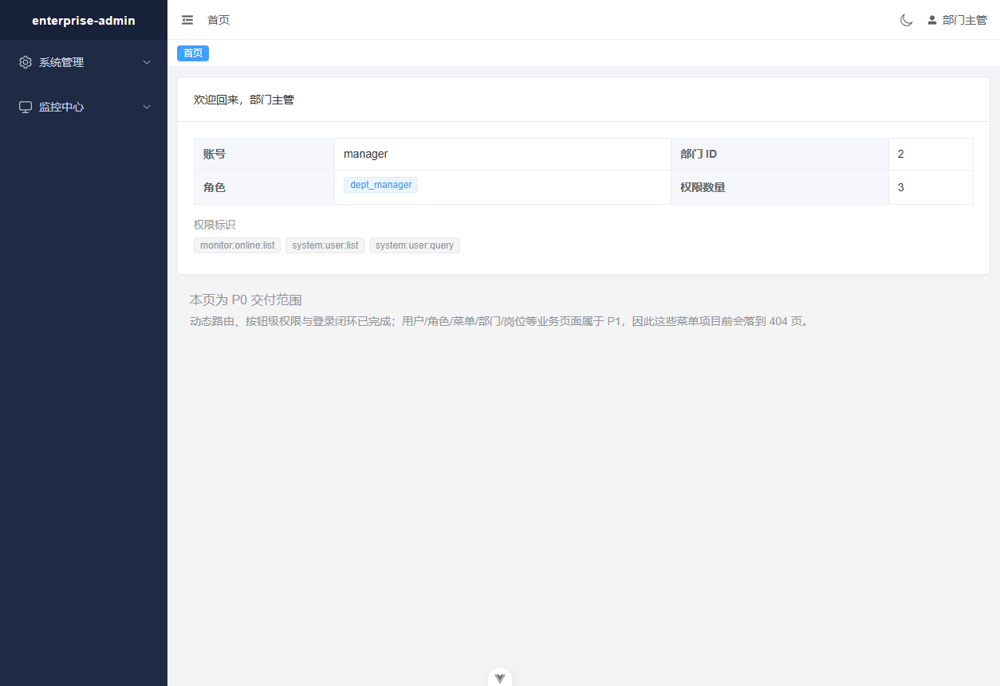
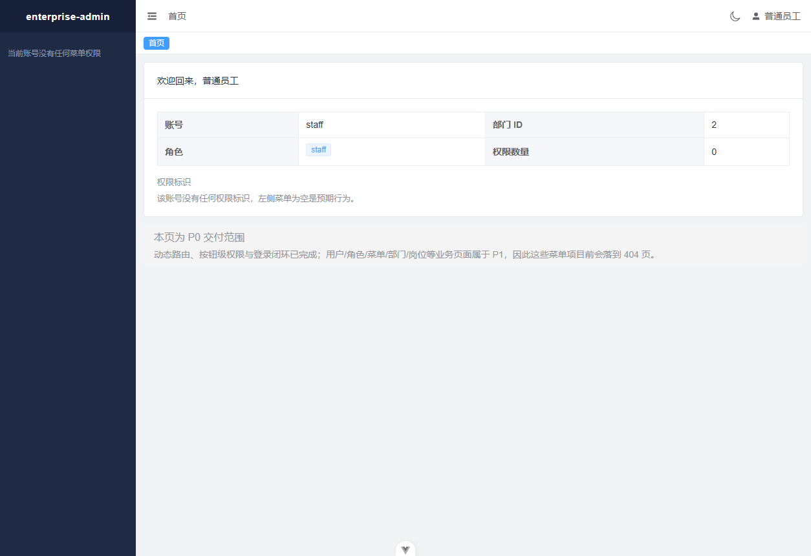

# P0 验收记录

- 验收日期：2026-10-17
- 验收对象：`feat/p0-foundation` 分支，HEAD `92397b1`（随后追加本记录）
- 验收方式：在**干净工作区**（`git status --porcelain` 为空）上运行全部自动化检查，
  并在真实进程 + 真实浏览器上跑通 S1

> 为什么强调「干净工作区」：本次实施过程中真的出现过一次 HEAD 跑不过自己测试的情况 ——
> Task 10 的一处 `CAPTCHA_ENABLED` 门控漏加进 `git add` 清单，在工作区里测试全绿、在 HEAD 上
> 4 条测试有 2 条失败。用 `git stash` 隔离工作区改动才暴露出来。此后「先确认工作区干净」成为
> 每次验收的第一步。

---

## 一、自动化测试

在 HEAD 上执行，工作区干净。

### 后端：122 项全通过（23.2s）

| 文件 | 数量 | 覆盖 |
|---|---|---|
| `test_auth.py` | 27 | 验证码、登录、锁定、令牌落库、登录日志 |
| `test_authz.py` | 23 | 令牌校验、登出失效、刷新轮换、权限判定、账号停用/删除 |
| `test_security.py` | 18 | bcrypt、JWT 签发/校验/过期/篡改、验证码字符集与 PNG |
| `test_response_and_errors.py` | 14 | 统一响应、异常映射、500 不泄漏、分页边界 |
| `test_cache.py` | 12 | TTL、并发自增原子性、清除 |
| `test_menu.py` | 12 | 树构建、路由下发、按钮/停用菜单排除、空权限 |
| `test_models_migration.py` | 10 | 11 张表、字符集、无唯一索引、逻辑删除过滤 |
| `test_captcha_toggle.py` | 4 | `CAPTCHA_ENABLED` 开/关两种配置 |
| `test_health.py` | 2 | 健康检查与 request-id |

```
122 passed in 23.24s
```

### 前端：32 项全通过

| 文件 | 数量 | 覆盖 |
|---|---|---|
| `utils/__tests__/request.spec.ts` | 10 | 令牌注入、响应解包、业务错误、**并发 401 单飞刷新**、重试上限、刷新失败清会话 |
| `stores/__tests__/permission.spec.ts` | 9 | 空菜单、组件映射、缺失组件降级、目录无组件、路由元信息、catch-all 顺序 |
| `stores/__tests__/user.spec.ts` | 6 | 登录存令牌、profile 填充、登出清理、登出失败仍清本地 |
| `directives/__tests__/hasPerm.spec.ts` | 7 | `v-hasPerm` / `v-hasRole` 保留与移除、通配符、多码任一 |

### 静态检查

| 检查 | 结果 |
|---|---|
| `vue-tsc --build` | 通过 |
| `npm run lint`（oxlint + eslint） | 0 warning / 0 error |
| `npm run build` | 通过 |
| `alembic check`（开发库与测试库） | 两次均 `No new upgrade operations detected.`（迁移与模型无漂移） |

---

## 二、S1 冷启动验收（计划书定义的刺激）

从**真正的冷状态**开始：先 `stop.ps1 -IncludeMysql`，确认 3306 / 8000 / 5173 全部空闲、
`mysqld` 进程数为 0。

| 步骤 | 命令 | 结果 |
|---|---|---|
| 初始化 | `powershell -ExecutionPolicy Bypass -File init.ps1` | exit 0；生成 `.env`、建库、两库迁移、幂等播种 |
| 启动 | `powershell -ExecutionPolicy Bypass -File start.ps1` | exit 0；MySQL + API + Vite 全部就绪 |
| 停止 | `powershell -ExecutionPolicy Bypass -File stop.ps1` | exit 0；两个端口释放，MySQL 按默认保留 |
| 再启动 | `start.ps1` | exit 0；三端口重新监听 |

### 浏览器验收（验证码保持启用，即安全默认）

自动化客户端读不到验证码（答案存在服务端进程内存里），因此**用人的方式**验收：截图后肉眼读取验证码。

| 场景 | 操作 | 观察结果 |
|---|---|---|
| 登录（admin） | 读取验证码 `3HJR` 后输入 | 跳转 `/dashboard`，侧边栏 14 项（系统管理 + 8 子项，监控中心 + 4 子项），顶栏显示「超级管理员」 |
| 登录（staff） | 读取验证码 `WBMH` 后输入 | 跳转 `/dashboard`，侧边栏 0 项并显示「当前账号没有任何菜单权限」，页面不白屏、控制台 0 error |
| 深链直达 | 直接访问 `/system/user` | 布局保留：面包屑「系统管理 / 用户管理」、标签页「首页, 用户管理」、菜单高亮「用户管理」 |
| 折叠侧栏 | 点击顶栏折叠图标 | 侧栏宽度 210px → 64px，品牌文字 `enterprise-admin` → `EA` |
| 未知路径 | 访问 `/this/path/does/not/exist` | 重定向到 `/404` 并渲染 404 页 |
| 登出 | 用户下拉 → 退出登录 | 跳回 `/login`，`ea_access_token` 与 `ea_refresh_token` 均为 `null`；再访问 `/dashboard` 被拦回 `/login?redirect=/dashboard` |
| 空提交 | 清空账号密码后点登录 | 0 次 `/auth/login` 请求；字段级提示「请输入账号」「请输入密码」；无令牌写入 |
| 错误密码 | 连续 6 次错误密码 | 第 1–4 次「用户名或密码错误」（与不存在账号提示一致）；第 5、6 次「密码错误次数过多，账号已锁定 10 分钟」 |
| 验证码刷新 | 点击验证码图片 | 换发新图（base64 长度 4634 → 3790） |

### 角色 → 菜单 的活体对照（RBAC 的核心主张）

同一套代码，只换登录账号，侧边栏内容随之变化 —— 这是「菜单/路由级权限」真正生效的证据：

| 账号 | 角色 | 侧边栏项数 | 具体菜单 | 控制台警告 |
|---|---|---|---|---|
| `admin` | 超级管理员 | **14** | 系统管理（用户/角色/菜单/部门/岗位/字典/参数/公告）+ 监控中心（操作日志/登录日志/在线用户/文件） | 12 条（12 个 P1 页面未实现，降级到 404） |
| `manager` | 部门主管 | **4** | 系统管理 → 用户管理；监控中心 → 在线用户 | 2 条（对应上表两个页面） |
| `staff` | 普通员工 | **0** | 无；显示「当前账号没有任何菜单权限」 | 0 条 |

`manager` 与 `staff` 的菜单差异来自种子数据里的 `sys_role_menu` 关联，不是前端硬编码；
后端 `GET /api/v1/auth/routers` 按登录用户的角色实时查询，前端只负责渲染它拿到的树。






---

## 三、Review Focus 逐条覆盖

计划书列出的 5 类「设计文档暗示、但不会被正向测试自然覆盖」的输入/失败模式，逐条对应到测试：

| # | 风险 | 对应测试 |
|---|---|---|
| 1 | **信息泄漏**：401 不区分失败原因；500 不含堆栈/SQL/连接串 | `test_security.py::test_token_failures_share_one_message`、`test_response_and_errors.py::test_unhandled_exception_hides_internals`（断言响应体中无 `Traceback`、`SELECT`、`Admin@123456`、`mysql+asyncmy`）、`test_auth.py::test_unknown_user_and_wrong_password_are_indistinguishable`、`test_auth.py::test_login_response_does_not_leak_password_hash`、`test_authz.py::test_profile_never_returns_password`、`test_authz.py::test_profile_rejects_garbage_token` |
| 2 | **逻辑删除与唯一性冲突** | `test_models_migration.py::test_user_name_has_no_unique_index`、`::test_deleted_rows_are_hidden_from_queries`、`::test_deleted_user_name_can_be_reused`、`::test_include_deleted_reveals_hidden_rows`、`test_auth.py::test_soft_deleted_account_cannot_log_in`、`test_authz.py::test_deleting_an_account_invalidates_its_live_token` |
| 3 | **令牌刷新竞态** | 前端 `request.spec.ts::refreshes once when three requests get 401 concurrently`（断言 refresh 调用次数恰为 1、三次重放均带新令牌）、`::gives up after one retry instead of looping`、`::does not try to refresh a 401 from the refresh endpoint itself`、`::clears tokens and signals session expiry when the refresh itself fails`；后端 `test_authz.py::test_refresh_rotates_and_rejects_the_old_refresh_token` |
| 4 | **分页与查询参数边界** | `test_response_and_errors.py::test_page_params_clamps_out_of_range`（99999→100）、`::test_page_params_negative_size_clamped`、`::test_page_params_rejects_non_numeric`（422）、`::test_page_params_accepts_boundary_values`、`test_auth.py::test_over_long_password_is_a_validation_error`（422 而非 500）、`test_auth.py::test_malformed_usernames_are_rejected_cleanly` |
| 5 | **空权限不白屏** | 后端 `test_authz.py::test_profile_of_a_permissionless_user_is_not_an_error`、`test_menu.py::test_routers_for_a_role_without_menus_is_an_empty_list`；前端 `permission.spec.ts::returns an empty list when there are no menus`；**活体证据**：用种子账号 `staff`（零权限）真实登录，见上文与截图 |

无遗漏条目。第 5 条同时具备自动化断言与真实浏览器证据。

### 第 1 条的额外加码：真实数据库故障，而非合成异常

自动化测试里的 `test_unhandled_exception_hides_internals` 抛的是一个人为构造的 `RuntimeError`。
为了确认这不是「测试通过但线上泄漏」，实测了一次**真实故障**：停掉 MySQL，保持 API 进程存活，然后
调用一个必须查库的接口。

| 请求 | 结果 |
|---|---|
| `GET /health`（不依赖数据库） | 200 —— 健康检查没有被数据库拖垮，符合预期 |
| `POST /api/v1/auth/login`（必须查库） | 500，响应体为 `{"code":500,"msg":"系统内部错误，请稍后重试","data":null}` |
| 响应体泄漏扫描 | **无命中**：`Traceback`、`asyncmy`、`sqlalchemy`、`mysql+`、`127.0.0.1:3306`、库名、`Admin@123456`、驱动的 `Access denied` 均未出现 |

真实的驱动异常被完整记入服务端日志（含 `request_id` 便于溯源），客户端只得到一句通用提示。

---

## 四、D 盘落位审计

| 内容 | 路径 | 大小 |
|---|---|---|
| MySQL 程序 | `D:\devtools\mysql-8.0.29` | 858 MB |
| MySQL 数据 | `D:\devtools\mysql-data` | 192.9 MB |
| MySQL 日志 | `D:\devtools\mysql-logs` | — |
| pip 缓存 | `D:\devtools\caches\pip` | 43.8 MB |
| npm 缓存 | `D:\devtools\caches\npm` | 398.8 MB |
| 后端虚拟环境 | `D:\work\enterprise-admin\backend\.venv` | 112 MB |
| 前端依赖 | `D:\work\enterprise-admin\frontend\node_modules` | 246.3 MB |

- npm registry 与 cache 由**项目级** `frontend/.npmrc` 指定，未改动用户的全局 npm 配置。
- pip 的 cache-dir 由 **venv 级** `backend/.venv/pip.ini` 指定（`init.ps1` 自动创建），
  `pip cache dir` 现解析为 `d:\devtools\caches\pip`。

**已知且无法避免的 C 盘写入**（如实记录）：

1. Python 解释器（`C:\Python312`）与 Node.js 为本机既有安装，未重装。
2. `C:\Users\Administrator\AppData\Local\pip\cache` 下存在 2 个文件（40 KB），时间戳为
   2026-10-11，**早于本项目**（2026-10-17），是系统 pip 的既有缓存，未做改动。
3. C 盘存在 `C:\Program Files\Git`（git 本身）。

项目自身的代码、依赖、数据库、日志、缓存均不在 C 盘。

---

## 五、本次验收未覆盖的范围（不做虚假声明）

- **数据权限（`data_scope` 的行级过滤）**：表结构与字段已就位，实现属于 P1。P0 无业务列表查询，
  强行写测试只能是假验收。
- **业务页面**：用户/角色/菜单/部门/岗位等的 CRUD 页面属于 P1，因此点击这些菜单会落到 404 页
  （控制台有明确警告，非白屏）。这是计划书 P0 定义的范围。
- **生产化加固**：HTTPS、令牌改 httpOnly Cookie、密钥托管、审计合规等，仅在 README
  「已知取舍」中列出，未声称具备。
