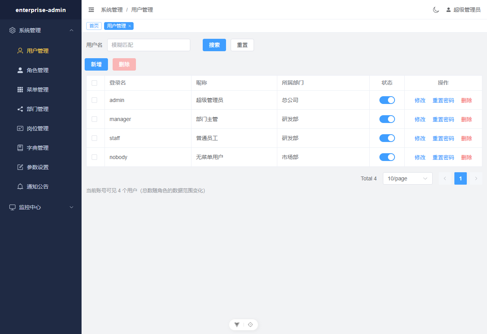
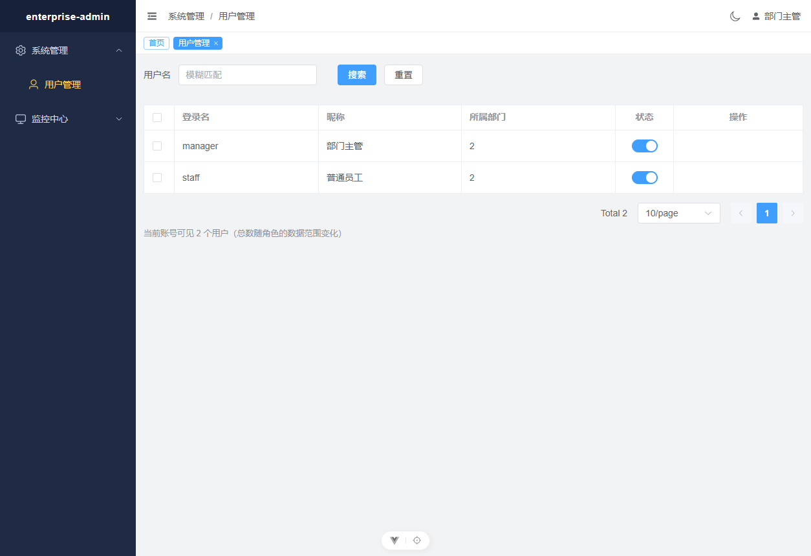

# P1-A 验收记录

- 验收日期：2026-10-20
- 验收对象：分支 `feat/p0-foundation`，`HEAD = 117bc81`（加上本轮两个缺陷修复）
- 验收方式：在**干净工作区**上跑全部自动化检查，然后**在真实进程 + 真实浏览器里逐页点击**

> 本记录只写**实际观察到**的东西。凡是没跑过的，第 6 节逐条列出，不做「应该没问题」的推断。

---

## 一、自动化检查

```
后端 pytest      283 passed
前端 vitest       40 passed（5 个文件）
vue-tsc --build   通过
npm run build     通过
eslint            0 errors 0 warnings
```

### 后端 257 项，逐文件

| 文件 | 数量 | 覆盖 |
|---|---|---|
| `test_auth.py` | 27 | 验证码、登录、令牌落库、登录日志 |
| `test_authz.py` | 23 | 令牌校验、登出失效、刷新轮换、权限判定 |
| `test_data_scope.py` | 25 | 五种数据范围、递归 CTE、多角色并集、失败关闭、3 条 HTTP 接线断言 |
| `test_post.py` | 24 | 岗位 CRUD、业务键唯一性、**接口层分页边界 6 条** |
| `test_role.py` | 22 | 角色 CRUD、**admin 角色三重自锁保护**、数据范围写入/清空、删除清理、用户授权 |
| `test_dept.py` | 20 | 部门树、**移动后整棵子树路径重写**、环检测、删除守卫、同级重名 |
| `test_security.py` | 18 | bcrypt、JWT 签发/校验/篡改 |
| `test_menu_crud.py` | 17 | 三类节点的差异化校验、`route_name` 唯一、物理删除与角色关联清理 |
| `test_menu.py` | 15 | 树构建、路由下发、停用角色不下发菜单 |
| `test_response_and_errors.py` | 14 | 统一响应、异常映射、500 不泄漏 |
| `test_cache.py` | 12 | TTL、并发自增原子性 |
| `test_user_write.py` | 11 | 用户写入、密码重置（走真实登录验证）、**不能删/停用自己**、最后一个超管保护 |
| `test_models_migration.py` | 10 | 12 张表、字符集、无唯一索引、逻辑删除过滤 |
| `test_oper_log.py` | 15 | 操作日志：**密码脱敏**、失败也留痕、查询筛选、删除时写自己的审计行 |
| `test_user_list.py` | 8 | **数据权限在 HTTP 层的实际效果**（行数与 total 随角色变化） |
| `test_lockout.py` | 5 | 锁定按账号而非按输入拼写计数 |
| `test_login_log.py` | 11 | 登录日志查询：筛选、**结束日期为闭区间**、畸形日期 400、倒序、真实登录落库 |
| `test_captcha_toggle.py` | 4 | `CAPTCHA_ENABLED` 开/关 |
| `test_health.py` | 2 | 健康检查、request-id |

---

## 二、接口清单（从 `openapi.json` 生成，非手写）

运行中的服务实测 **48 条**路由：健康检查 1 + 认证 6 + 系统模块 37 + 监控模块 4。

### 认证（6）

| 方法 | 路径 | 权限 |
|---|---|---|
| GET | `/auth/captchaImage` | 无（登录前） |
| POST | `/auth/login` | 无（登录前） |
| POST | `/auth/logout` | 登录即可 |
| POST | `/auth/refresh` | 无（凭 refresh 令牌） |
| GET | `/auth/profile` | 登录即可 |
| GET | `/auth/routers` | 登录即可 |

### 部门（6）

`GET /system/dept`（树，不分页）、`GET /system/dept/{id}`、`POST`、`PUT`、`DELETE /{id}`、
`GET /system/dept/treeselect`
权限码：`system:dept:list` / `:query` / `:add` / `:edit` / `:remove`

### 岗位（6）

`GET /system/post`（分页）、`GET /system/post/{id}`、`POST`、`PUT`、`DELETE /{ids}`（批量）、
`GET /system/post/optionselect`
权限码：`system:post:*`

### 菜单（7）

`GET /system/menu/list`（树）、`GET /{id}`、`POST`、`PUT`、`DELETE /{id}`、
`GET /treeselect`、`GET /roleMenuTreeselect/{roleId}`
权限码：`system:menu:*`

### 角色（12）

`GET /system/role`（分页）、`GET /{id}`、`POST`、`PUT`、`DELETE /{ids}`、
`PUT /changeStatus`、**`PUT /dataScope`**、
`GET /authUser/allocatedList`、`GET /authUser/unallocatedList`、
`PUT /authUser/selectAll`、`PUT /authUser/cancelAll`、`PUT /authUser/cancel`
权限码：`system:role:*`

### 用户（6）

`GET /system/user`（分页，**受数据权限约束**）、`POST`、`PUT`、`DELETE /{ids}`、
`PUT /resetPwd`、`PUT /changeStatus`
权限码：`system:user:*`

### 监控（1）

`GET /monitor/loginlog`（分页；筛选：账号 / 状态 / 日期区间）
权限码：`monitor:loginlog:list`

> 只提供「读」。**刻意没有删除接口** —— 审计日志能被接口抹除，就等于没有审计；
> 真要清理应当是一次受控的运维动作。

> `docs/接口清单.md` 的 §3 保留的是 **P0 时期的历史快照**（当时这些接口确实都不存在），
> 已在该节顶部加了指向本节的横幅。两份文档不冲突：一份记录「当时没有」，一份记录「现在有」。

---

## 三、浏览器验收证据

真实进程（`start.ps1` 一键启动：MySQL + uvicorn + Vite）、真实浏览器、**验证码保持启用**。

### 3.1 五个管理页面实际渲染

以 `admin`（`*:*:*`）登录，逐页访问：

| 页面 | 表头 | 首次加载行数 | 控制台错误 |
|---|---|---|---|
| 部门管理 | 部门名称 / 排序 / 负责人 / 联系电话 / 状态 / **层级路径** / 操作 | 4（共 4 个部门） | 0 |
| 岗位管理 | 岗位编码 / 岗位名称 / 排序 / 状态 / 备注 / 操作 | 3 | 0 |
| 角色管理 | 角色名称 / 权限字符串 / 排序 / **数据范围** / 状态 / 操作 | 4 | 0 |
| 菜单管理 | 菜单名称 / **类型** / 排序 / 路由地址 / 组件路径 / 权限标识 / 状态 / 操作 | 33（共 33 个节点，含按钮） | 0 |
| 用户管理 | 登录名 / 昵称 / 所属部门 / 状态 / 操作 | 4 | 0 |

五个页面**全部无 404、无控制台错误**。

### 3.2 S2 验收：同一接口，不同角色，不同可见行

这是最初约定的成功标准（「两个不同角色登录 → 菜单不同、按钮不同、可见数据行数不同」）。
用两个账号登录同一个 `GET /api/v1/system/user` 所在的页面：

| 账号 | 数据范围 | 可见用户 | 具体行 | 操作按钮 |
|---|---|---|---|---|
| `admin` | 全部数据 | **4** | admin(总公司)、manager(研发部)、staff(研发部)、nobody(市场部) | 全部可见 |
| `manager` | 本部门及以下（dept=2） | **2** | manager(研发部)、staff(研发部) | **全部隐藏** |

`admin` 能跨 3 个部门看到 4 个人；`manager` 只看得到自己部门那 2 个，且因为缺少
`system:user:edit` / `system:user:remove`，操作列整列为空 —— **数据权限与按钮级权限在同一次
对照里同时可见**。

`total` 也随之变化（4 vs 2），页面底部有对应提示：「当前账号可见 N 个用户（总数随角色的数据范围变化）」。

截图：





---

## 四、验收中发现并修复的缺陷

浏览器验收的价值在这一轮体现得很直接：**三个缺陷里有两个是单元测试与类型检查都抓不到的**。

### 4.1 用户管理页：辅助请求失败导致主列表根本不加载（严重）

`onMounted` 原本是：

```ts
const [tree, roles] = await Promise.all([deptTreeSelect(), listRoles({...})])
deptTree.value = tree
roleOptions.value = roles.rows
await fetchList()
```

`manager` 只有 `system:user:list`，没有 `system:dept:list` / `system:role:list`。两个辅助请求
返回 403 → **整个 `Promise.all` 抛错 → `fetchList()` 从未执行**。结果是页面显示
「当前账号可见 **0** 个用户」并弹两个「没有操作权限」。

这不是权限生效，而是**页面在撒谎**：同样的账号直接调 `/api/v1/system/user` 明明能拿到 2 行。

修复：辅助数据不再是主列表的前置条件，按权限码决定要不要请求，失败也只降级为空选项：

```ts
if (hasPermission(userStore.perms, ['system:dept:list'])) {
  deptTree.value = await deptTreeSelect().catch(() => [])
}
if (hasPermission(userStore.perms, ['system:role:list'])) {
  roleOptions.value = await listRoles({...}).then((d) => d.rows).catch(() => [])
}
await fetchList()   // 无论如何都执行
```

修复后同一账号看到 2 个用户（见 3.2 截图）。

### 4.2 仪表盘上的一句过时文案

首页原本写着「用户/角色/菜单/部门/岗位等业务页面属于 P1，因此这些菜单项目前会落到 404 页」。
五个页面上线后这句话变成假的。改为说明当前账号的菜单与按钮由权限码决定。

### 4.3 构建门禁：`vue-tsc --build` 通过 ≠ 能构建

本轮之前（第 12 轮）出现过「只跑 type-check 就提交，结果 `vite build` 失败」的情况。
此后前端门禁一律以 **`npm run build`** 为准，本轮两个页面一次通过。

### 4.4 Element Plus 没有配置中文 locale（界面中英混排）

点开任意删除确认框，按钮是 **`Cancel` / `OK`**，而界面其余部分全是中文。原因是 `main.ts` 从未
给 Element Plus 配 locale，组件自带文案保持默认英文（分页的 `per page`、日期选择器等同样受影响）。

修复：在 `App.vue` 外层套 `el-config-provider :locale="zhCn"`（用 config-provider 而不是
`app.use(ElementPlus)`，是为了不放弃 unplugin 的按需导入）。修复后确认框为「取消 / 确定」。

这个缺陷**只有真的点开一次确认框才看得见** —— 静态检查、单元测试、甚至「页面能渲染」的检查都不会报。

---

## 五、写路径验收（2026-10-20 补验）

第一轮验收只覆盖了「页面能渲染 + 数据权限生效」，写操作没有浏览器证据。本轮补齐：

### 5.1 数据范围设置弹窗 —— 全链路

| 步骤 | 结果 |
|---|---|
| 角色页点「数据范围」 | 弹窗打开，标题「数据范围 —— 部门主管」，五种范围单选齐全 |
| 选「自定义部门」 | 条件字段「部门 / 选择可见部门」出现（`v-if` 生效） |
| 展开部门树并勾选「研发部」 | 树显示 总公司/研发部/市场部/财务部，选中后标签显示「研发部」 |
| 提交 | 提示「数据范围已更新」，表格该行显示变为**自定义部门** |
| **查库** | `sys_role.data_scope = 2`，`sys_role_dept` 关联到「研发部」 |
| 改回「本部门及以下」再提交 | 表格显示回到「本部门及以下」 |
| **查库（关键）** | `data_scope = 4`，且 `sys_role_dept` 关联行数 **= 0** |

最后一行验证的是 P1-A-22 那条裁定：**切走「自定义」时必须清空旧的部门关联**，否则把范围改回来时
旧的部门会静静复活、可见范围比使用者以为的更宽。这条以前只有 pytest 证据，现在有了 UI → 数据库的完整链路。

### 5.2 部门新增与删除

| 步骤 | 结果 |
|---|---|
| 部门页点「新增」→ 填名「验收临时部门」→ 确定 | 提示「新增成功」，表格 4 → 5 行 |
| 点该行「删除」→ 确认 | 提示「删除成功」，表格回到 4 行 |
| **查库** | 该行仍在，`del_flag = 2`（软删除，不是物理删除） |

### 5.3 用户新增表单（最复杂的一个）

| 步骤 | 结果 |
|---|---|
| 用户页点「新增」 | 弹窗打开；角色下拉加载出 4 个角色（超级管理员/部门主管/普通员工/无菜单角色） |
| 填登录名 `qa_temp`、昵称、密码 | — |
| 所属部门：展开部门树选「市场部」 | 树正常展开，选中生效 |
| 角色：选「部门主管」 | 多选生效 |
| 提交 | 提示「新增成功」，列表 4 → 5 行 |
| **查库** | `dept=市场部`、`roles=dept_manager`、**`password` 是 bcrypt 哈希** |

这一条同时证明了：部门树、角色多选、密码哈希三条链路都在真实界面上走通。

### 5.4 菜单新增表单（按类型切换字段）

| 步骤 | 结果 |
|---|---|
| 菜单页点「新增」，选节点类型「按钮」 | **路由地址 / 组件路径 / 路由名称 / 显示状态四个字段消失**，只剩 上级菜单/节点类型/菜单名称/权限标识/图标/排序/状态 |
| 上级菜单选「系统管理」、填名称与权限标识 | — |
| 提交 | 提示「新增成功」，节点数 33 → 34 |
| **查库** | `menu_type=F`、`perms=qa:temp:view`、`parent=系统管理`、`component=NULL` |

字段随类型出现/消失是这一页的设计要点（目录不能有组件、菜单必须有、按钮必须有权限码），
现在有了 UI 层的证据。

### 5.5 岗位与角色表单，以及自锁守卫在界面上的表现

| 步骤 | 结果 |
|---|---|
| 岗位页「新增」→ 填 `qa_post` / 验收临时岗位 → 确定 | 提示「新增成功」，3 → 4 行 |
| 角色页「新增」→ 填 验收临时角色 / `qa_role` → 确定 | 提示「新增成功」，4 → 5 行；查库 `data_scope=1`（默认全部数据） |
| **点 `admin` 角色的状态开关** | 提示「超级管理员角色是内置的，不允许删除、停用或修改权限字符串」，**开关自动回弹为开启** |

最后一行是「自锁守卫」在界面层的证据：后端拒绝（400），前端的 `toggleStatus` 捕获后重新拉取，
所以开关不会停留在错误的位置。这条以前只有 pytest 证据。

### 5.6 清理与删除语义（顺带验证）

两条临时记录都通过界面删除：

| 对象 | 界面结果 | 数据库结果 |
|---|---|---|
| 菜单「验收临时按钮」 | 删除成功，34 → 33 节点 | **物理删除**，该行 0 条 |
| 用户 `qa_temp` | 删除成功，5 → 4 行 | **软删除**，行仍在且 `del_flag = 2` |

两者语义不同是**故意的**：`sys_menu` 没有 `del_flag`（残留的权限码比不可逆删除更糟），
`sys_user` 有。同一次验收里把两种语义都验证到了。

### 5.7 编辑（PUT）路径

建一条临时岗位 `qa_edit`（名称「改之前」）→ 点「修改」→ **弹窗回填了原值「改之前」** → 改成「改之后」→
确定 → 提示「修改成功」，表格显示「改之后」→ 删除清理。

这一条同时证明了两件事：编辑表单能正确加载现有数据（回填），以及 `PUT` 提交后列表会刷新。
查库确认该行最终为软删除（`del_flag = 2`），活跃岗位回到 3 条。

### 5.8 侧边栏折叠子项

以 `admin` 登录，侧边栏共 **14 项**，`系统管理` 下的子项（用户/角色/菜单/部门/岗位/字典/参数/公告）
与 `监控中心` 下的子项（操作日志/登录日志/在线用户/文件管理）**都已渲染进 DOM**。
P0 记录的「admin 14 项菜单」得到复核。

> 注意：字典/参数/公告/操作日志/登录日志/文件管理这 7 项**点进去仍是 404** ——
> 它们属于 P2，视图文件不存在。演示时应避开，或按 `docs/接口清单.md` §3.7 起的说明处理。

---

### 5.9 登录日志页（P2 的第一个模块）

「监控中心 → 登录日志」原本点进去是 404：数据从 P0 起就在写（每次登录成功与失败都落一行），
但从来没有读它的接口。第 23 轮补上了后端查询 + 前端页面。

浏览器实测（`admin` 登录）：

| 项 | 结果 |
|---|---|
| 表头 | 登录账号 / 状态 / IP / 地点 / 浏览器 / 操作系统 / 消息 / 登录时间 |
| 数据 | **14 条真实记录**（就是本项目这些天真实登录留下的），每页 10 条，倒序 |
| 控制台错误 | 0 |

这一页的价值在**失败行**：账号锁定与撞库只能靠事后翻这些记录发现，所以状态筛选与「失败」的红色标签
比别的都重要。页面上没有任何删除按钮，理由与后端一致：审计可被抹除就等于没有审计。

### 5.10 操作日志（第 24 轮）

「登录日志」回答「谁进来了」，这一块回答「谁做了什么」。写入者是接口上的 `@oper_log` 装饰器
（不是中间件 —— 中间件只看得到 URL 和状态码，看不到「这次是新增用户还是删除角色」）。

浏览器实测（`admin`）：

| 步骤 | 结果 |
|---|---|
| 在用户页新建一个用户 | 操作日志页出现 1 条：模块=用户管理、类型=新增、操作人=admin、方式=POST、URL=/api/v1/system/user、IP=127.0.0.1 |
| 再删除该用户 | 变成 2 条，新增与删除各一条，删除那条的 URL 是 `/api/v1/system/user/6` |
| 控制台错误 | 0 |

**最要紧的一条断言（查库验证）**：

```
oper_param = {"user_name": "logged_qa", ..., "password": "***", ...}
SELECT COUNT(*) FROM sys_oper_log WHERE oper_param LIKE '%<真实密码>%'  →  0
```

请求体里的密码在后端写入时就被替换成 `***`，且**逐层递归**处理嵌套结构 —— 只处理第一层会让
`{"user": {"newPassword": ...}}` 这类载荷漏出去。页面不做二次脱敏：如果展示层还得补救，
说明后端漏了，那是要修后端的事。

另外两条设计取舍：

- **失败也留痕**：`BusinessException` 会被记成 `status=1` 并带上 `error_msg`，然后原样抛给调用方。
  只记成功的日志回答不了「谁尝试了什么」。
- **写日志绝不能影响业务**：记录环节的任何异常都被吞掉并降级为一条 warning —— 审计重要，
  但不值得用「记不上就 500」去换。
- **删除/清空本身留痕**：先删，再写一条 `delete_oper_logs` / `clean_oper_logs` 的记录，
  这样「谁清掉了审计」永远查得到。删除权限单独一个码（`monitor:operlog:remove`），
  能看日志不等于能删日志。

---

## 六、本次验收**未覆盖**的范围（不做虚假声明）

1. **编辑（PUT）只在岗位模块验过**。五个模块的新增与删除都在浏览器里实测过，
   编辑路径已用岗位验证（含表单回填），其余四个模块的 `PUT` 仍只有后端测试覆盖 ——
   它们与 `POST` 共享同一套校验，风险低，但不等于已验证。
2. **三个以上角色的菜单对照**。P0 做过 admin/manager/staff 三档菜单数量对照（14/4/0）；
   本轮只做了 admin 与 manager 在用户列表页的对照。
3. **未做**：多标签页令牌刷新竞态、并发写冲突、超过 100 条的深分页、移动端/窄屏布局。
4. **未实现**：字典、参数、公告、在线用户、服务监控、文件上传
   （设计文档 §8.3 里的 P2 部分，见 `docs/接口清单.md` §3.7 起）。
   **登录日志查询已在第 23 轮实现**（见 §5.9），**操作日志已在第 24 轮实现**（见 §5.10）。

---

## 七、D 盘落位（本次复核）

本轮没有新增安装。既有事实不变：MySQL 程序 `D:\devtools\mysql-8.0.29`、数据
`D:\devtools\mysql-data`、日志 `D:\devtools\mysql-logs`、pip/npm 缓存均在 `D:\devtools\caches`、
venv 与 node_modules 在项目内。不可控的 C 盘项仍是既有的 Python 解释器、Node 与 Git 本体
（P0 验收记录 §四 已逐条列出）。
