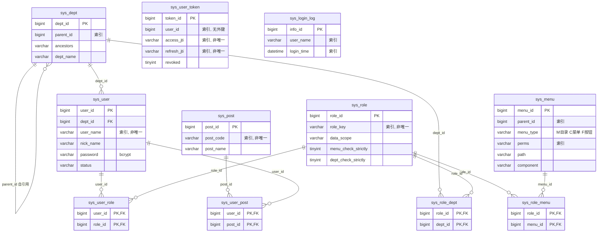

# 数据库设计

- 文档日期：2026-10-17
- 适用范围：**P0 已交付的 11 张表**（`feat/p0-foundation` 分支）

> **更新（P1 之后）**：设计文档 §5 规划的 17 张表**已全部落地**。P0 建了 11 张，
> 之后依次新增迁移 `0002_oper_log`、`0003_dict`（两张）、`0004_config`、`0005_notice`、`0006_file`，
> 共 17 张。本文正文描述的是 P0 那 11 张表（它记录的是一次已经验收过的交付），
> 第 8 节现在标注了后来补齐的情况。
- 事实来源：`backend/app/models/*.py` + `backend/alembic/versions/0001_core_auth_tables.py`，
  并与**真实运行实例**交叉核对（`enterprise_admin` 库，MySQL 8.0.29）

> **核对方法**：本文的表结构、索引名、外键名、`AUTO_INCREMENT`、字符集与排序规则全部来自对
> 运行中 MySQL 的 `information_schema` 与 `SHOW CREATE TABLE` 查询，不是从模型文件推演的。
> 凡是模型声明与落库结果不一致的地方，文中都单独列出（见 §7.3）。
> 设计文档 §5 里 17 张表的完整规划中，**P0 只落地了 11 张** —— 缺失的 6 张见 §8。

---

## 1. 总览

| # | 表 | ORM 类 | 模型文件 | 混入 | 行数（开发库现状） |
|---|---|---|---|---|---|
| 1 | `sys_dept` | `SysDept` | `models/dept.py` | `TimestampMixin` + `SoftDeleteMixin` + `RemarkMixin` | 4 |
| 2 | `sys_post` | `SysPost` | `models/post.py` | `TimestampMixin` + `SoftDeleteMixin` + `RemarkMixin` | 3 |
| 3 | `sys_user` | `SysUser` | `models/user.py` | `TimestampMixin` + `SoftDeleteMixin` + `RemarkMixin` | 4 |
| 4 | `sys_role` | `SysRole` | `models/role.py` | `TimestampMixin` + `SoftDeleteMixin` + `RemarkMixin` | 4 |
| 5 | `sys_menu` | `SysMenu` | `models/menu.py` | `TimestampMixin` + `RemarkMixin`（**无** `SoftDeleteMixin`） | 24 |
| 6 | `sys_user_role` | `SysUserRole` | `models/associations.py` | 无 | 4 |
| 7 | `sys_role_menu` | `SysRoleMenu` | `models/associations.py` | 无 | 29 |
| 8 | `sys_user_post` | `SysUserPost` | `models/associations.py` | 无 | 0 |
| 9 | `sys_role_dept` | `SysRoleDept` | `models/associations.py` | 无 | 0 |
| 10 | `sys_user_token` | `SysUserToken` | `models/token.py` | 无 | 7 |
| 11 | `sys_login_log` | `SysLoginLog` | `models/login_log.py` | 无 | 7 |
| — | `alembic_version` | — | Alembic 自建 | — | 1 |

所有表引擎 `InnoDB`，排序规则 `utf8mb4_0900_ai_ci`，表注释为空。
`tests/test_models_migration.py::test_core_tables_exist` 守着"11 张表都在"这件事，
`::test_tables_use_utf8mb4` 守着"`sys_%` 表的排序规则恰好只有 `utf8mb4_0900_ai_ci`"。

`models/__init__.py` 把 11 个类全部导入并列入 `__all__`。这不是风格问题：模块 docstring 写明
Alembic 的 autogenerate 与全局逻辑删除过滤器都依赖 `Base.metadata` 和 mapper registry，
**只认识真正被导入过的类**。

---

## 2. 共享列（三个 mixin）

`app/db/base.py` 定义了三个 mixin，按需组合。

### 2.1 `TimestampMixin`（:15）

| 列 | 模型声明 | 落库 DDL | 说明 |
|---|---|---|---|
| `create_by` | `String(64)`, `default=None` | `varchar(64) DEFAULT NULL` | 创建者 |
| `create_time` | `DateTime`, `server_default=func.now()` | `datetime DEFAULT (now())` | 创建时间 |
| `update_by` | `String(64)`, `default=None` | `varchar(64) DEFAULT NULL` | 更新者 |
| `update_time` | `DateTime`, `server_default=func.now()`, **`onupdate=func.now()`** | `datetime DEFAULT (now())` | 更新时间 |

注意 `update_time`：`server_default` 是**数据库**层面的默认值（插入时生效），`onupdate` 是
**ORM 层面**的行为（`mapped_column` 的 `onupdate` 由 SQLAlchemy 在执行 UPDATE 时生成 `SET` 子句）。
落库 DDL 里**没有** `ON UPDATE CURRENT_TIMESTAMP` 子句 —— 证据是上面的 `SHOW CREATE TABLE` 输出。
因此：**走原始 SQL 或直接在数据库里改数据，`update_time` 不会自动刷新**；只有经 ORM 的更新才会。

### 2.2 `SoftDeleteMixin`（:28）

| 列 | 模型声明 | 落库 DDL |
|---|---|---|
| `del_flag` | `String(1)`, `default='0'`, `server_default='0'`, **`nullable=False`** | `varchar(1) NOT NULL DEFAULT '0'` |

取值 `DelFlagEnum.EXISTS = "0"` / `DelFlagEnum.DELETED = "2"`（`core/constants.py:16`）。注意是
`varchar(1)` 而不是设计文档 §5.1 表格里写的 `char(1)`。

`timestamp`/`soft_delete` 的组合方式：模型基类按 `class X(Base, TimestampMixin, SoftDeleteMixin, RemarkMixin)`
的顺序声明。

### 2.3 `RemarkMixin`（:43）

| 列 | 模型声明 | 落库 DDL |
|---|---|---|
| `remark` | `String(500)`, `default=None` | `varchar(500) DEFAULT NULL` |

**为什么单独拆一个 mixin 而不是并进 `TimestampMixin`**（`base.py:45-47` 的 docstring）：
纯追加的日志表与会话表需要审计时间戳，但不需要备注列。实际效果是 `sys_user_token` 与
`sys_login_log` **都不带** `create_by/create_time/update_by/update_time`，它们的时间语义由
`login_time` 承担。

---

## 3. ER 图

`sys_user_token` 与 `sys_login_log` 是**孤立表**：它们不参与任何外键关系（`user_id` 只是一个带
索引的普通列，没有 `FOREIGN KEY`）。这一点在设计上有意为之，理由见 §7.4。

---

## 4. 逐表结构

下面每一张表的列，`类型` 一列取自真实 `SHOW CREATE TABLE`；`可为空` 与 `默认值` 同理。

### 4.1 `sys_dept`（部门，树形）

| 列 | 类型 | 可为空 | 默认值 | 注释 |
|---|---|---|---|---|
| `dept_id` | `bigint` | 否 | `AUTO_INCREMENT` | 部门ID（主键） |
| `parent_id` | `bigint` | 否 | `0` | 父部门ID |
| `ancestors` | `varchar(50)` | 否 | — | 祖级列表 |
| `dept_name` | `varchar(50)` | 否 | — | 部门名称 |
| `order_num` | `int` | 否 | `0` | 显示顺序 |
| `leader` | `varchar(20)` | 是 | `NULL` | 负责人 |
| `phone` | `varchar(11)` | 是 | `NULL` | 联系电话 |
| `email` | `varchar(50)` | 是 | `NULL` | 邮箱 |
| `status` | `varchar(1)` | 否 | `'0'` | 部门状态(0正常 1停用) |
| `create_by` / `create_time` / `update_by` / `update_time` | — | — | — | 见 §2.1 |
| `del_flag` | `varchar(1)` | 否 | `'0'` | 删除标志(0存在 2删除) |
| `remark` | `varchar(500)` | 是 | `NULL` | 备注 |

索引：`PRIMARY KEY (dept_id)`、`KEY ix_sys_dept_parent_id (parent_id)`（非唯一）。
外键：无（`parent_id` 不建外键，避免删除顺序与自引用约束的麻烦）。

`ancestors` 的语义在 `models/dept.py:14-16` 交代：树同时用 `parent_id` + 物化的祖级路径
`"0,100,101"` 存储，路径让"X 是否是 Y 的后代"能在热路径上用 `LIKE` 回答。种子数据的写法见
`scripts/seed_data.py:187`：根节点是 `"0"`，子节点是 `f"{parent.ancestors},{parent.dept_id}"`。

### 4.2 `sys_post`（岗位）

| 列 | 类型 | 可为空 | 默认值 | 注释 |
|---|---|---|---|---|
| `post_id` | `bigint` | 否 | `AUTO_INCREMENT` | 岗位ID |
| `post_code` | `varchar(64)` | 否 | — | 岗位编码(业务键) |
| `post_name` | `varchar(50)` | 否 | — | 岗位名称 |
| `post_sort` | `int` | 否 | `0` | 显示顺序 |
| `status` | `varchar(1)` | 否 | `'0'` | 状态(0正常 1停用) |
| 四个审计列 + `del_flag` + `remark` | — | — | — | 见 §2 |

索引：`PRIMARY KEY (post_id)`、`KEY ix_sys_post_post_code (post_code)`（非唯一）。外键：无。

### 4.3 `sys_user`（用户账号）

| 列 | 类型 | 可为空 | 默认值 | 注释 |
|---|---|---|---|---|
| `user_id` | `bigint` | 否 | `AUTO_INCREMENT` | 用户ID |
| `dept_id` | `bigint` | **是** | `NULL` | 部门ID |
| `user_name` | `varchar(30)` | 否 | — | 用户账号 |
| `nick_name` | `varchar(30)` | 否 | — | 用户昵称 |
| `user_type` | `varchar(2)` | 否 | `'00'` | 用户类型(00系统用户) |
| `email` | `varchar(50)` | 是 | `NULL` | 邮箱 |
| `phonenumber` | `varchar(11)` | 是 | `NULL` | 手机号 |
| `sex` | `varchar(1)` | 否 | `'2'` | 性别(0男 1女 2未知) |
| `avatar` | `varchar(255)` | 是 | `NULL` | 头像地址 |
| `password` | `varchar(100)` | 否 | — | bcrypt 哈希 |
| `status` | `varchar(1)` | 否 | `'0'` | 账号状态(0正常 1停用) |
| `login_ip` | `varchar(128)` | 是 | `NULL` | 最后登录IP |
| `login_date` | `datetime` | 是 | `NULL` | 最后登录时间 |
| `pwd_update_date` | `datetime` | 是 | `NULL` | 密码最后更新时间 |
| 四个审计列 + `del_flag` + `remark` | — | — | — | 见 §2 |

索引：`PRIMARY KEY (user_id)`、`KEY ix_sys_user_dept_id (dept_id)`、`KEY ix_sys_user_user_name (user_name)`。
外键：`sys_user_ibfk_1 FOREIGN KEY (dept_id) REFERENCES sys_dept (dept_id)`（**无 `ON DELETE` 子句**，
默认 `RESTRICT`）。

`password` 是 `varchar(100)`：bcrypt 输出恒为 60 字符（`$2b$12$` + 53），`varchar(100)` 留有余量。
`pwd_update_date` 列存在，但 **P0 没有任何代码写它**（`grep pwd_update_date` 只命中模型与迁移）。

**关系加载策略**（`models/user.py:59-65`）——这一处直接影响运行时行为，值得记住：

| 关系 | 策略 | 原因（模型注释） |
|---|---|---|
| `dept` | `lazy="joined"` | 认证路径每个请求都要 dept 与 roles；异步下的隐式懒加载会抛 `MissingGreenlet` |
| `roles` | `lazy="selectin"`（secondary=`sys_user_role`） | 同上 |
| `posts` | `lazy="selectin"`（secondary=`sys_user_post`） | 用户列表要渲染岗位名 |

**没有声明反向关系**（如 `SysRole.users`）。`docs/P0决策记录.md` 二节记录了这个取舍：反向关系会让
每次角色列表查询都把该角色的所有用户拖出来。代价是反向查询要显式 join。

### 4.4 `sys_role`（角色）

| 列 | 类型 | 可为空 | 默认值 | 注释 |
|---|---|---|---|---|
| `role_id` | `bigint` | 否 | `AUTO_INCREMENT` | 角色ID |
| `role_name` | `varchar(30)` | 否 | — | 角色名称 |
| `role_key` | `varchar(100)` | 否 | — | 角色权限字符串 |
| `role_sort` | `int` | 否 | `0` | 显示顺序 |
| `data_scope` | `varchar(1)` | 否 | `'1'` | 数据范围(1全部 2自定义 3本部门 4本部门及以下 5仅本人) |
| `menu_check_strictly` | `tinyint(1)` | 否 | `1` | 菜单树选择项是否父子联动 |
| `dept_check_strictly` | `tinyint(1)` | 否 | `1` | 部门树选择项是否父子联动 |
| `status` | `varchar(1)` | 否 | `'0'` | 角色状态(0正常 1停用) |
| 四个审计列 + `del_flag` + `remark` | — | — | — | 见 §2 |

索引：`PRIMARY KEY (role_id)`、`KEY ix_sys_role_role_key (role_key)`（非唯一）。外键：无。

`data_scope` 是 `varchar(1)` 而 `DataScopeEnum` 是 `IntEnum`，所以模型用
`default=str(int(DataScopeEnum.ALL))` 把 `1` 转成字符串 `"1"`（`models/role.py:31-32`）。

> **重要现状**：`data_scope` 与 `menu_check_strictly` / `dept_check_strictly` 三列**P0 只有存储，
> 没有任何读取方**。数据权限（第 ④ 层）属于 P1，`sys_role_dept` 表也没有代码查询它。

### 4.5 `sys_menu`（目录 / 菜单 / 按钮 三型树）

| 列 | 类型 | 可为空 | 默认值 | 注释 |
|---|---|---|---|---|
| `menu_id` | `bigint` | 否 | `AUTO_INCREMENT` | 菜单ID |
| `menu_name` | `varchar(50)` | 否 | — | 菜单名称 |
| `parent_id` | `bigint` | 否 | `0` | 父菜单ID |
| `order_num` | `int` | 否 | `0` | 显示顺序 |
| `path` | `varchar(200)` | **是** | `NULL` | 路由地址 |
| `component` | `varchar(255)` | 是 | `NULL` | 组件路径 |
| `query` | `varchar(255)` | 是 | `NULL` | 路由参数 |
| `route_name` | `varchar(50)` | **是** | `NULL` | 路由名称 |
| `is_frame` | `int` | 否 | `1` | 是否外链(0是 1否) |
| `is_cache` | `int` | 否 | `0` | 是否缓存(0缓存 1不缓存) |
| `menu_type` | `varchar(1)` | 否 | `'C'` | 菜单类型(M目录 C菜单 F按钮) |
| `visible` | `varchar(1)` | 否 | `'0'` | 显示状态(0显示 1隐藏) |
| `status` | `varchar(1)` | 否 | `'0'` | 菜单状态(0正常 1停用) |
| `perms` | `varchar(100)` | 是 | `NULL` | 权限标识(如 system:user:add) |
| `icon` | `varchar(100)` | 是 | `NULL` | 菜单图标 |
| 四个审计列 + `remark` | — | — | — | 见 §2；**无 `del_flag`** |

索引：`PRIMARY KEY (menu_id)`、`KEY ix_sys_menu_parent_id (parent_id)`、`KEY ix_sys_menu_perms (perms)`（均非唯一）。
外键：无。

**一张表承载三种节点**（`models/menu.py:1-11`）：`M` 目录（纯分组节点，没有页面）、`C` 菜单（真实页面，
驱动一条动态路由）、`F` 按钮（没有路由，只为了携带一个 `perms` 权限码）。这就是这张表同时带
路由列（`path`/`component`/`route_name`）和授权列（`perms`）的原因。

`query` 列存在但 **P0 无任何代码写入或读取**（保存路由参数的扩展位）。

### 4.6 四张纯关联表

| 表 | 列 | 主键 | 外键 |
|---|---|---|---|
| `sys_user_role` | `user_id`, `role_id` | `(user_id, role_id)` | `sys_user_role_ibfk_1 → sys_role.role_id ON DELETE CASCADE`、`ibfk_2 → sys_user.user_id ON DELETE CASCADE` |
| `sys_role_menu` | `role_id`, `menu_id` | `(role_id, menu_id)` | `sys_role_menu_ibfk_1 → sys_menu.menu_id ON DELETE CASCADE`、`ibfk_2 → sys_role.role_id ON DELETE CASCADE` |
| `sys_user_post` | `user_id`, `post_id` | `(user_id, post_id)` | `sys_user_post_ibfk_1 → sys_post.post_id ON DELETE CASCADE`、`ibfk_2 → sys_user.user_id ON DELETE CASCADE` |
| `sys_role_dept` | `role_id`, `dept_id` | `(role_id, dept_id)` | `sys_role_dept_ibfk_1 → sys_dept.dept_id ON DELETE CASCADE`、`ibfk_2 → sys_role.role_id ON DELETE CASCADE` |

每张表除复合主键外，还都有一个**由 MySQL 自动创建的非唯一二级索引**（因为 `ON DELETE CASCADE`
的外键需要索引）：`sys_user_role.role_id`、`sys_role_menu.menu_id`、`sys_user_post.post_id`、
`sys_role_dept.dept_id`。注意复合主键的第一列（`user_id` / `role_id`）已经由主键本身覆盖，
所以没有额外的单列索引。

四张表**没有任何审计列**（无时间戳、无 `del_flag`、无 `remark`），这是 `models/associations.py:1-6`
的明确决定：它们只是"两个实体相关"这个事实本身，没有行为，所以集中放在一个文件里。

`sys_role_dept` 支撑 `data_scope = 2`（自定义数据范围），但**P0 没有任何代码查询它**（`0` 行）。

### 4.7 `sys_user_token`（令牌会话记录）

| 列 | 类型 | 可为空 | 默认值 | 注释 |
|---|---|---|---|---|
| `token_id` | `bigint` | 否 | `AUTO_INCREMENT` | 令牌记录ID |
| `user_id` | `bigint` | 否 | — | 用户ID（索引，**无外键**） |
| `access_jti` | `varchar(64)` | 否 | — | 访问令牌唯一标识（索引，**非唯一**） |
| `access_expire` | `datetime` | 否 | — | 访问令牌过期时间 |
| `refresh_jti` | `varchar(64)` | 否 | — | 刷新令牌唯一标识（索引，**非唯一**） |
| `refresh_expire` | `datetime` | 否 | — | 刷新令牌过期时间 |
| `login_ip` | `varchar(128)` | 否 | — | 登录IP |
| `browser` | `varchar(64)` | 否 | — | 浏览器 |
| `os` | `varchar(64)` | 否 | — | 操作系统 |
| `login_time` | `datetime` | 否 | `(now())` | 登录时间 |
| `revoked` | `tinyint(1)` | 否 | `0` | 是否已撤销 |

索引：`PRIMARY KEY (token_id)`、`KEY ix_sys_user_token_access_jti`、`KEY ix_sys_user_token_refresh_jti`、
`KEY ix_sys_user_token_user_id`（三条均非唯一）。外键：**无**。

这张表**没有** `del_flag`、没有 `create_time`/`update_time`、没有 `remark` —— 它不在
`SoftDeleteMixin`/`TimestampMixin`/`RemarkMixin` 的任何一个里，直接继承 `Base`。

### 4.8 `sys_login_log`（登录审计）

| 列 | 类型 | 可为空 | 默认值 | 注释 |
|---|---|---|---|---|
| `info_id` | `bigint` | 否 | `AUTO_INCREMENT` | 访问ID |
| `user_name` | `varchar(30)` | 否 | — | 登录账号（索引） |
| `ipaddr` | `varchar(128)` | 否 | — | 登录IP |
| `login_location` | `varchar(255)` | 否 | — | 登录地点 |
| `browser` | `varchar(64)` | 否 | — | 浏览器 |
| `os` | `varchar(64)` | 否 | — | 操作系统 |
| `status` | `varchar(1)` | 否 | — | 登录状态(0成功 1失败) |
| `msg` | `varchar(255)` | 否 | — | 提示消息 |
| `login_time` | `datetime` | 否 | `(now())` | 登录时间（索引） |

索引：`PRIMARY KEY (info_id)`、`KEY ix_sys_login_log_login_time`、`KEY ix_sys_login_log_user_name`。外键：无。

追加型表（`models/login_log.py:1-5`）：成功与失败都记，因为失败行正是"锁定或撞库"事后可见的唯一
凭据。`login_location` 列存在但**P0 永远写空串**（`log_service.py:31` 硬编码 `login_location=""`），
IP 归属地解析属于 P2。

---

## 5. 索引总表（来自 `information_schema.statistics`）

| 表 | 索引名 | 唯一 | 列 |
|---|---|---|---|
| `sys_dept` | `PRIMARY` | 是 | `dept_id` |
| | `ix_sys_dept_parent_id` | 否 | `parent_id` |
| `sys_post` | `PRIMARY` | 是 | `post_id` |
| | `ix_sys_post_post_code` | 否 | `post_code` |
| `sys_user` | `PRIMARY` | 是 | `user_id` |
| | `ix_sys_user_dept_id` | 否 | `dept_id` |
| | `ix_sys_user_user_name` | 否 | `user_name` |
| `sys_role` | `PRIMARY` | 是 | `role_id` |
| | `ix_sys_role_role_key` | 否 | `role_key` |
| `sys_menu` | `PRIMARY` | 是 | `menu_id` |
| | `ix_sys_menu_parent_id` | 否 | `parent_id` |
| | `ix_sys_menu_perms` | 否 | `perms` |
| `sys_user_role` | `PRIMARY` | 是 | `user_id`, `role_id` |
| | `role_id` | 否 | `role_id` |
| `sys_role_menu` | `PRIMARY` | 是 | `role_id`, `menu_id` |
| | `menu_id` | 否 | `menu_id` |
| `sys_user_post` | `PRIMARY` | 是 | `user_id`, `post_id` |
| | `post_id` | 否 | `post_id` |
| `sys_role_dept` | `PRIMARY` | 是 | `role_id`, `dept_id` |
| | `dept_id` | 否 | `dept_id` |
| `sys_user_token` | `PRIMARY` | 是 | `token_id` |
| | `ix_sys_user_token_access_jti` | 否 | `access_jti` |
| | `ix_sys_user_token_refresh_jti` | 否 | `refresh_jti` |
| | `ix_sys_user_token_user_id` | 否 | `user_id` |
| `sys_login_log` | `PRIMARY` | 是 | `info_id` |
| | `ix_sys_login_log_login_time` | 否 | `login_time` |
| | `ix_sys_login_log_user_name` | 否 | `user_name` |

**全库唯一的唯一索引就是各个 `PRIMARY`。** 没有任何 `UNIQUE KEY`。这不是疏漏，见 §6.1。

---

## 6. 设计取舍

### 6.1 `user_name` / `role_key` / `post_code` 故意没有唯一索引

模型里三处都留了注释（`models/user.py:27-29`、`models/role.py:23-24`）：

> Indexed but deliberately NOT unique: a logically deleted account must not block re-creating the
> same name.

理由：逻辑删除后，`del_flag = '2'` 的行**仍在表里**。如果 `user_name` 上建了 `UNIQUE`，那么
"删掉用户 `zhangsan`，再建一个 `zhangsan`"会在第二条插入时撞唯一键失败 —— 而业务上这条记录
根本不应该算存在。

代价与配套：

1. 查询性能靠普通索引 `ix_sys_user_user_name` 承担，这一点没有损失。
2. 代价落在**正确性**上：可能出现两条 `user_name` 相同、`del_flag` 同为 `'0'` 的活记录。
   `auth_service._find_user` 用的是 `db.scalar(...)`，会**静默取第一条**。
3. 因此唯一性必须由 **service 层在事务内校验** —— 这正是设计文档 §5.1 与 README 承诺的东西。

> ### ⚠ P0 的真实状态：这个 service 层校验**不存在**
>
> **设计文档 §5.1 与 `README.md` 第 190 行都写着"唯一性由 service 层在事务内校验"，
> 但代码里没有任何这样的校验。** 已核对：
>
> - `grep` `unique|duplicate|already exists|已存在` 在整个 `backend/app/` 只命中
>   `_dummy_password_hash` 的 `uuid4()`、`route_name` 唯一性注释等无关位置；
> - `backend/app/services/` 下**没有**用户/角色/岗位的创建逻辑（P0 没有创建接口）。
>
> 现在不构成缺陷，因为 P0 没有任何创建接口，**产生不了重复**；种子脚本
> （`scripts/seed_data.py` 的 `_get_or_create`）走的是"先按业务键查，存在就跳过"的路径。
> 但 **P1 用户/角色/岗位 CRUD 落地之前必须补上这个校验**，否则一旦出现两条同名活记录，
> `_find_user` 会静默取第一条。这一条已列在 `docs/P0决策记录.md` 第四节第 1 条。
>
> **被证明的范围**：`tests/test_models_migration.py::test_user_name_has_no_unique_index` 断言
> `information_schema.statistics` 里 `sys_user.user_name` 的 `non_unique` 全为 1（即无唯一索引）；
> `::test_deleted_user_name_can_be_reused` 在 **ORM 层**证明"已删同名 + 新建同名"两条能共存。
> 也就是说"无唯一索引"这一点被验证了，"唯一性由 service 校验"这一点**没有被验证，因为不存在**。
> `role_key` 与 `post_code` 同理（只有模型注释，没有对应测试）。

### 6.2 `sys_menu` 没有 `del_flag`

类 docstring（`models/menu.py:22-26`）：

> Deliberately has no `del_flag`: a removed menu must actually disappear, otherwise its `perms`
> code would linger in the permission set of every role that held it.

这是本设计里最值得讲的一个取舍。`perms` 是权限码的来源：`get_current_user` 把用户每个启用角色的
每个启用菜单的 `perms` 收进权限集合（`deps.py:50-59`）。如果菜单也被逻辑删除，那么"删掉一个菜单"
的结果是：菜单不再显示，但它的 `perms` **仍然留在所有曾持有它的角色的权限集里** —— 一个被撤销的
权限点继续放行接口调用。这在安全语义上比"菜单没删干净"严重得多。

代价（`docs/P0决策记录.md` 二节明确写出）：**删菜单不可逆**。而这恰好是种子/重置流程想要的语义。

### 6.3 `sys_user_token` 为什么存在

`models/token.py:1-7` 把答案写在了模块 docstring 里：

> A purely stateless JWT cannot be revoked, so "log out", "force logout" and the online-user list all
> need a server-side record keyed by `jti`. The cost is one indexed lookup per authenticated request;
> the benefit is that logging out actually means something.

展开成具体能力：

| 能力 | 依赖这张表的哪一部分 |
|---|---|
| 登出立即失效 | `get_current_user` 按 `access_jti` + `revoked=0` 查行（`deps.py:83-88`） |
| 刷新轮换 + 防重放 | `refresh_tokens` 按 `refresh_jti` 查行并置 `revoked=True`（`auth_service.py:243-257`） |
| 登出连带结束 refresh 会话 | `revoke_by_access_jti` 撤销**整行**而非单个 jti（`auth_service.py:284-296`） |
| 在线用户列表（P1） | 按 `revoked=0 AND access_expire > now` 过滤 |
| 强制下线（P1） | 按 `token_id` 撤销一行 |

代价是每个已认证请求多一次索引查询（`ix_sys_user_token_access_jti`）。设计文档 §5.5 说"用缓存
吸收"这个开销 —— **P0 没有这个缓存**：`get_current_user` 每次都真的查库，`grep` 确认
`deps.py` 里没有 `cache` 引用。这是一个未兑现的设计意图，如实记录。

**为什么 `user_id` 不建外键**：这张表是**会话流水**。建了外键（哪怕带 `ON DELETE CASCADE`）就
把"删用户"和"清会话"绑成一次数据库级联操作，而 P0 的删除语义是逻辑删除（`del_flag` 翻牌，
物理行不消失），外键根本不会触发。更要紧的是：`sys_user_token` 是"令牌是否仍然可撤销"的唯一依据，
把它挂在用户表的物理行上，会让任何未来的物理清理动作静默销毁撤销记录。所以它只留一个带索引的
普通 `user_id` 列，由应用自己决定会话生死 —— 实际实现就是这样：`get_current_user` 先查会话行，
再单独查用户状态，两步都通过才放行（`deps.py:83-98`）。

**为什么 `access_jti` / `refresh_jti` 不建唯一索引**：设计文档 §5.5 描述为"唯一"，**落库是非唯一
索引**，两者不一致。这一条已经被独立评审识别，列在 `docs/P0决策记录.md` 第四节第 3 条：

> 设计文档 §5.5 称 `access_jti`/`refresh_jti` 唯一，迁移建的是**非唯一**索引；`refresh_tokens` 用
> `db.scalar()` 取首行 → 碰撞概率极低，但文档与 schema 不一致 → 顺手对齐（加唯一索引或改文档）

`jti` 是 `uuid4().hex`（`security.py:79`），碰撞在实践中不会发生；真正的风险是**文档与 schema 不一致**
本身。本文记录的是 **schema 的事实**：非唯一。

### 6.4 `DEFAULT` 与 `COLLATE` 为什么是这样

| 事实 | 值 | 原因 |
|---|---|---|
| 库/表/列排序规则 | `utf8mb4_0900_ai_ci`（全部 11 张表） | `my.ini` 的 `collation-server=utf8mb4_0900_ai_ci` + `character-set-server=utf8mb4`；连接串也带 `?charset=utf8mb4`（`config.py:69`） |
| `ai_ci` 的副作用 | **大小写不敏感、重音不敏感** | `ADMIN` 与 `admin` 命中同一行。这正是 `_lockout_key` 必须 `casefold()` 归一化的原因（`auth_service.py:52-60`） |
| 主键 `AUTO_INCREMENT` | `bigint` 自增 | 设计文档 §5 约定 |
| 字符串状态列默认值 | `'0'`（`status` / `del_flag` / `visible`） | 与 `StatusEnum.NORMAL` / `DelFlagEnum.EXISTS` 对齐；`core/constants.py:1-3` 警告"这些值就是落库的字符串，**永远不要重新编号**" |
| `create_time` / `update_time` | `DEFAULT (now())` | MySQL 8.0.13+ 的表达式默认值语法。**注意这不是 `DEFAULT CURRENT_TIMESTAMP`**，但它等价地让"不带该列的 INSERT"也拿到时间 |
| `data_scope` 默认值 | `'1'` | `DataScopeEnum.ALL`；超管与"未配置"都落到"全部数据" |
| `menu_check_strictly` / `dept_check_strictly` | `tinyint(1) DEFAULT 1` | 布尔列；`Boolean` + `server_default=text("1")` |
| `revoked` | `tinyint(1) DEFAULT 0` | 布尔列 |
| `user_type` | `'00'` | 若依系约定，"00 = 系统用户" |
| `sex` | `'2'` | "2 = 未知"，让"没填"有一个明确取值而不是 NULL 或空串 |
| `menu_type` | `'C'` | 菜单是最常见的节点类型 |
| `is_frame` | `1` | "1 = 不是外链"（默认不开外链） |
| `is_cache` | `0` | "0 = 缓存" |

**时区**：应用存的是 naive UTC（`app/utils/timeutil.py` 的 `utcnow()` 返回
`datetime.now(timezone.utc).replace(tzinfo=None)`），库端 `my.ini` 设 `default-time-zone='+00:00'`，
实测 `@@time_zone = +00:00`。`timeutil.py` 的 docstring 说明了两边必须一致的理由：否则同一行里
`create_time`（服务端 `now()`）与 `access_expire`（应用写入）会处于不同时区，这类 bug 会以
"过期令牌仍然有效"的形式在几个月后浮现。`docs/P0决策记录.md` 一节记录了这条决定。

`DATETIME`（而非 `TIMESTAMP`）的选择是配套的：`TIMESTAMP` 会被 MySQL 按时区转换，`DATETIME` 原样
存取，这样"库里存的就是 UTC 字面量"这件事成立。

### 6.5 为什么有些列在模型里"看起来有默认值"却落库为 `NULL`

模型里这三处写了 Python 侧默认值，**没有** `server_default`：

| 列 | 模型 | 落库 DDL |
|---|---|---|
| `sys_menu.path` | `default=""` | `varchar(200) DEFAULT NULL` |
| `sys_menu.route_name` | `default=""` | `varchar(50) DEFAULT NULL` |
| `sys_dept.ancestors` | `default=""` | `varchar(50) NOT NULL`（无默认值） |

`mapped_column(default=...)` 是**ORM 插入时**填的值，不会生成 `DEFAULT` 子句。后果：

- 通过 ORM 插入而不给这些字段 → 得到空串；
- 通过**原始 SQL** 插入而不给 → `path` / `route_name` 得到 `NULL`，`ancestors` 直接**插入失败**
  （`NOT NULL` 且无默认值）。

这不是 bug，但它意味着"列的默认值"在两条路径上不一致 —— 写原始 SQL 的脚本必须自己带值。
`scripts/seed_data.py` 全程走 ORM，所以不受影响。

---

## 7. 迁移与模型的一致性

### 7.1 迁移文件

唯一一支迁移：`backend/alembic/versions/0001_core_auth_tables.py`，`revision = "0001"`，
`down_revision = None`，`Create Date: 2026-10-17 18:39:22`。`upgrade()` 建 11 张表 + 9 个非主键
索引；`downgrade()` 按外键依赖的逆序 drop。

建表顺序（`upgrade`）：`sys_dept` → `sys_login_log` → `sys_menu` → `sys_post` → `sys_role` →
`sys_user_token` → `sys_role_dept` → `sys_role_menu` → `sys_user` → `sys_user_post` → `sys_user_role`。
（Alembic autogenerate 会按依赖排序，`sys_user` 晚于它引用的 `sys_dept`。）

`alembic/env.py` 的 URL 解析有三层（docstring 写了顺序）：`config.attributes["sqlalchemy_url"]`
（测试套件以编程方式设置）→ `-x db=<name>`（只覆盖库名）→ 应用 settings。`compare_type=True` 在
offline 与 online 两条路径都开了 —— 注释说明原因："Without this, changing a column's type or
length produces an empty migration and the drift goes unnoticed."

`alembic.ini` 的 `sqlalchemy.url` 留空，避免凭据进版本库；`env.py` 里 `import app.models` 带
`# noqa: F401` 与"Never remove, even while it looks unused"的注释 —— 它存在的意义就是让
`Base.metadata` 拿到全部 11 个类。

### 7.2 迁移与模型是否有漂移

`docs/P0验收记录.md` 记录了两次 `alembic check`（开发库与测试库）均为
`No new upgrade operations detected.`。本文撰写时**未重新执行** `alembic check`（它需要写权限与
数据库连接），所以"当前无漂移"这一条的权威依据是那份验收记录，不是本文的实测。

### 7.3 模型声明与落库 DDL 的差异清单

这是本文撰写时实际发现的、逐条核对过的差异。它们大多是"无实质影响"的，但必须点名，
因为"模型文件读起来是这样，数据库里是那样"正是最容易让人误判的地方。

| # | 位置 | 模型声明 | 落库 DDL | 影响 |
|---|---|---|---|---|
| 1 | `sys_menu.route_name`、`sys_menu.path` | `default=""`（Python 侧） | `DEFAULT NULL` | 原始 SQL 插入会得到 `NULL`；`menu_service._to_route` 用 `or ""` / `or None` 兜住了 |
| 2 | `sys_dept.ancestors` | `default=""`，无 `server_default`，落库 `NOT NULL` | `varchar(50) NOT NULL`（无默认值） | 原始 SQL 插入**必须**带值，否则报错 |
| 3 | `TimestampMixin.update_time` | `server_default=func.now()` + `onupdate=func.now()` | `DEFAULT (now())`，**无 `ON UPDATE`** | 非 ORM 路径的更新不会刷新 `update_time` |
| 4 | `SoftDeleteMixin.del_flag` | `String(1)` | `varchar(1)` | 设计文档 §5.1 写的是 `char(1)`；实现用 `varchar(1)` |
| 5 | `sys_user_token.access_jti` / `refresh_jti` | `index=True` | 非唯一索引 | 设计文档 §5.5 称"唯一"，**文档与 schema 不一致**（`docs/P0决策记录.md` 四.3） |
| 6 | `sys_user.user_name` | `index=True` + 注释"不是 UNIQUE" | `KEY ix_sys_user_user_name`，非唯一 | 与设计文档 §5.2 称"唯一业务键"不一致；这是**有意的**设计（§6.1） |
| 7 | 全部 11 张表 | 模型未声明 `mysql_default_charset` / `mysql_collate` | 全部 `utf8mb4` / `utf8mb4_0900_ai_ci` | 来自服务端 `my.ini` 的默认值，不来自模型；换一个 MySQL 实例需同步该配置 |

第 5 条是**真实的不一致**（文档 vs schema），第 6 条是**有意的取舍被文档描述得含糊**，
其余各条是 ORM 语义与 DDL 语义的正常分工。

---

## 8. P0 未落地的表 —— **现已全部补齐**

设计文档 §5 的完整数据模型包含 17 张表，P0 只落地了 11 张。下面 6 张在 P0 时**确实不存在**；
P1 之后补齐了，现状见最后一列。

| 表 | 设计文档位置 | 用途 | P0 状态 | 现状 |
|---|---|---|---|---|
| `sys_dict_type` | §5.4 | 字典类型 | 不存在 | ✅ 迁移 `0003` |
| `sys_dict_data` | §5.4 | 字典数据 | 不存在 | ✅ 迁移 `0003` |
| `sys_config` | §5.4 | 参数配置 | 不存在 | ✅ 迁移 `0004` |
| `sys_notice` | §5.4 | 通知公告 | 不存在 | ✅ 迁移 `0005` |
| `sys_oper_log` | §5.5 | 操作日志 | 不存在（也没有 `@oper_log`） | ✅ 迁移 `0002`，装饰器在 `services/oper_log_service.py` |
| `sys_file` | §5.6 | 文件记录 | 不存在（也没有 `StorageBackend`） | ✅ 迁移 `0006`，抽象在 `services/storage.py` |

核对方式：`backend/app/models/__init__.py` 的 `__all__` 现在有 17 个类；
`backend/alembic/versions/` 有 `0001`–`0006` 六支迁移；
`information_schema.tables` 里 `sys_*` 表恰好 11 张。

种子数据里出现的"字典管理""参数设置""通知公告""文件管理"是 **`sys_menu` 行**（`scripts/seed_data.py`
的 `MENUS` 常量），它们只是导航条目，指向的前端页面属于 P1 —— 点击会降级到 404 页，这是
`docs/P0验收记录.md` 第三节如实记录的行为。

---

## 9. 种子数据（开发库当前状态）

`scripts/seed_data.py` 是幂等的，`python -m scripts.seed_data` 可重复执行。

| 内容 | 行数 | 关键字段 |
|---|---|---|
| 部门 | 4 | 总公司(根, `ancestors="0"`) → 研发部/市场部/财务部（`ancestors="0,1"` 等） |
| 岗位 | 3 | `ceo`/董事长、`se`/项目经理、`hr`/人力资源 |
| 角色 | 4 | `admin`(data_scope=1)、`dept_manager`(data_scope=**4**)、`staff`(data_scope=5)、`no_menu`(data_scope=5) |
| 菜单 | 24 | 系统管理(M) + 8 个 C 页 + 若干 F 按钮；监控中心(M) + 4 个 C 页 |
| 角色-菜单关联 | 29 | `admin` 拿到全部（`ROLE_MENUS["admin"] = "*"`）；`dept_manager` 5 条；`staff` / `no_menu` **空** |
| 用户 | 4 | `admin` / `manager` / `staff` / `nobody` |
| 用户-角色关联 | 4 | 每人一个角色 |
| 用户-岗位关联 | 0 | 只有 `manager` 带 `post_codes=["se"]`，但该用户已存在时种子会跳过 |
| 令牌会话 | 7 | 运行时产生的登录记录 |
| 登录日志 | 7 | 运行时产生的成功/失败记录 |

播种策略有一处值得注意：菜单用 `_upsert_presentation`（`seed_data.py:148-174`），即**已存在的行
会被刷新展示字段**（`MENU_MUTABLE_FIELDS` 里的 13 个字段），目的是让"常量即事实来源"这句话成立 ——
改了图标再跑一次种子不会被静默忽略。用户与角色用 `_get_or_create`，**已存在就完全不碰**，
`seed_users` 里有一行注释"Never silently reset a password on a re-run; say so instead"。

`data_scope=4`（本部门及以下）目前只是 `sys_role.data_scope` 列里的一个字符，**不影响任何查询**
（§4.4 与 `docs/架构设计.md` §6 的第 ④ 层）。
