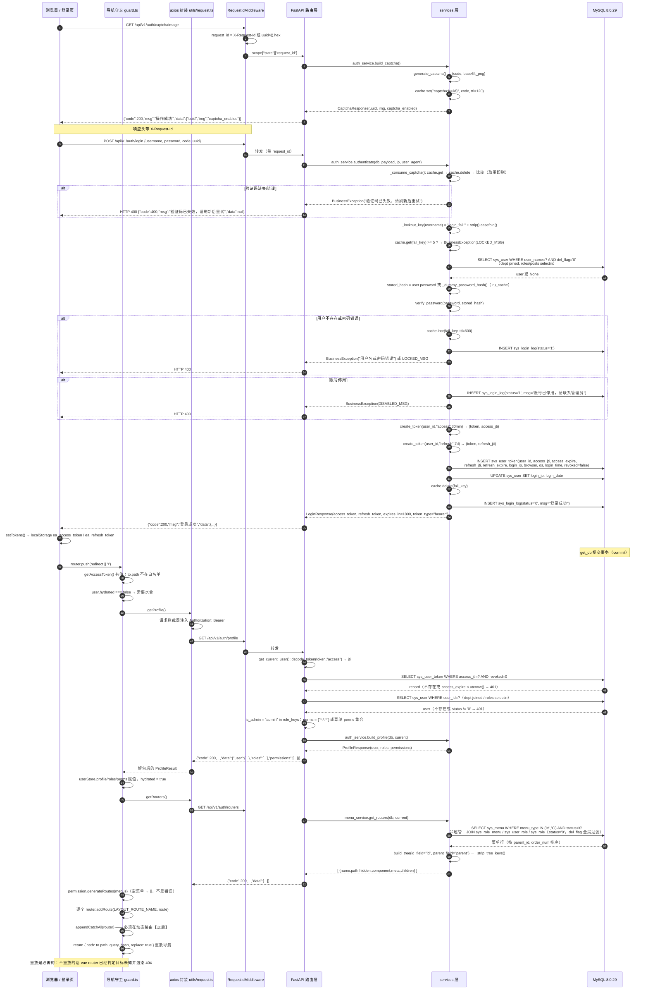
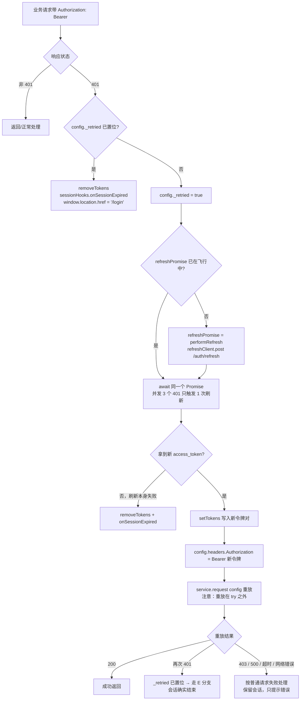

# 架构设计

- 文档日期：2026-10-17
- 适用范围：**P0 已交付的代码**（`feat/p0-foundation` 分支，后端 130 项测试、前端 40 项测试全绿）
- 目标读者：项目所有者、后续接手开发者

> **本文的写法**：每一句都必须能在仓库里找到对应代码。P0 尚未实现的能力一律在**它本该出现的位置**标注
> 「P1」，而不是塞进脚注或"后续规划"。文中所有路径以仓库根 `D:\work\enterprise-admin` 为基准。

---

## 1. 技术栈与运行时事实

| 层 | 选型 | 实测版本 | 依据 |
|---|---|---|---|
| 后端框架 | FastAPI | 0.143.3 | `backend/.venv/Lib/site-packages/fastapi-0.143.3.dist-info` |
| ASGI 工具库 | Starlette | 1.8.0 | `starlette-1.8.0.dist-info` |
| ORM | SQLAlchemy（asyncio） | 2.1.5 | `sqlalchemy-2.1.5.dist-info` |
| 驱动 | asyncmy | 0.2.16 | `asyncmy-0.2.16.dist-info` |
| 校验 / 配置 | pydantic / pydantic-settings | 2.14.1 / 2.16.0 | 同上 |
| 认证 | PyJWT / bcrypt | 2.15.1 / 5.0.0 | `pyjwt-2.15.1.dist-info`、`bcrypt-5.0.0.dist-info` |
| 验证码图像 | Pillow | 13.0.0 | `pillow-13.0.0.dist-info` |
| 日志 | loguru | 0.7.3 | `loguru-0.7.3.dist-info` |
| 迁移 | Alembic | 1.20.0 | `alembic-1.20.0.dist-info` |
| 数据库 | MySQL 便携版 | 8.0.29（`MySQL Community Server - GPL`） | `SELECT VERSION(), @@version_comment` |
| 服务器 | uvicorn | 见 `backend/requirements.txt` | — |

后端入口：`backend/app/main.py` 末尾的 `app = create_app()`。前端入口：`frontend/src/main.ts`。

---

## 2. 目录分层

```
backend/app/
├─ main.py            应用装配：setup_logging() → create_app() → 中间件 → 异常处理器 → 路由
├─ api/v1/            路由层
│  ├─ router.py       api_router（prefix = settings.API_V1_PREFIX，即 /api/v1）
│  └─ auth.py         6 个认证端点
├─ services/          业务层
│  ├─ auth_service.py 验证码、凭据校验、锁定、令牌签发与落库、刷新轮换、登出
│  ├─ menu_service.py 菜单树 → 动态路由载荷
│  └─ log_service.py  登录审计落库
├─ schemas/           Pydantic 出入参：auth.py、common.py
├─ models/            ORM 映射：user / role / menu / dept / post / token / login_log / associations
├─ db/                引擎、会话、逻辑删除全局过滤
├─ core/              配置、安全原语、缓存、异常、统一响应、常量、鉴权依赖
├─ middlewares/       request_id.py
└─ utils/             tree.py、timeutil.py、request_info.py
```

前端的对应关系（本文件只涉及与后端契约相关的部分）：

| 前端文件 | 职责 |
|---|---|
| `frontend/src/utils/request.ts` | axios 封装；单飞刷新；`sessionHooks` 注入副作用 |
| `frontend/src/utils/auth.ts` | `localStorage` 令牌读写（key `ea_access_token` / `ea_refresh_token`） |
| `frontend/src/api/auth.ts` | 6 个后端端点的薄封装 |
| `frontend/src/stores/user.ts` | `accessToken` / `refreshToken` / `profile` / `roles` / `perms` / `hydrated` |
| `frontend/src/stores/permission.ts` | `import.meta.glob` 组件映射、`generateRoutes`、`appendCatchAll` |
| `frontend/src/router/guard.ts` | 白名单、首次导航水合、兜底路由 |

---

## 3. 分层职责与分层规则

| 层 | 职责 | 禁止 | P0 现状 |
|---|---|---|---|
| `api/` | 参数解析、权限声明、调用 service、组装响应 | 写 SQL、写业务规则 | 遵守：`api/v1/` 下没有任何 `select(` / `text(` / `func.` / `update(` / `insert(` / `delete(` |
| `services/` | 业务规则、事务参与、树构建 | 依赖 FastAPI 的 Request/Response | 遵守：`services/` 下没有任何 `fastapi` / `starlette` 导入 |
| `models/` | ORM 映射、关系定义、列注释 | 业务判断 | 遵守 |
| `schemas/` | 入参校验、出参序列化 | 访问数据库 | 遵守 |
| `core/` | 配置、安全、缓存、异常、统一响应、鉴权依赖 | 依赖具体业务模块 | **有一处例外**：`core/deps.py` 导入 `app.models.user` / `app.models.token` / `app.db.session`；`core/` 依赖 `models/` 与 `db/` 是设计内的一部分（鉴权必须读会话表），但 `core/` 不依赖 `services/` |

复核命令（结果：无输出）：

```powershell
cd D:\work\enterprise-admin\backend
# 1) api/ 里不应有 SQL
Select-String -Path app\api\v1\*.py -Pattern 'select\(|text\(|func\.|update\(|insert\(|delete\('
# 2) services/ 里不应有 FastAPI/Starlette
Select-String -Path app\services\*.py -Pattern '^(from|import)\s+(fastapi|starlette)'
```

### 3.1 一处需要说明的跨层引用：`services/` → `core/deps.py`

`app/services/menu_service.py:14` 写的是 `from app.core.deps import CurrentUser`，而 `app/core/deps.py`
本身导入了 `fastapi`。这**没有**违反"`services/` 不依赖 FastAPI 的 Request/Response 对象"这条规则 ——
它取的是 `CurrentUser` 这个 `@dataclass`，而 `CurrentUser` 的字段（`user_id` / `user_name` / `dept_id` /
`is_admin` / `perms` / `access_jti`）全是纯 Python 类型，没有一个是 FastAPI 类型。真正的循环风险在
`auth_service.py` 侧被显式拆掉了：它用 `if TYPE_CHECKING:` 导入 `CurrentUser`，并在注释里写明
"avoids a circular import: app.core.deps imports this module"（`app/services/auth_service.py:36-37`）。

结论：**规则按"是否出现 FastAPI 的 Request/Response/HTTP 类型"判定，而不是按"是否 import 了 fastapi 这个包"判定。**
`services/` 目前的实际依赖是 SQLAlchemy 的 `AsyncSession`（`log_service.record_login_log` 的 `db` 参数）
和 `CurrentUser`。

---

## 4. 请求生命周期

### 4.1 完整的中间件栈

FastAPI 的 `add_middleware` 是**后加的在外层**。`app/main.py:80-89` 的顺序是：

```python
app.add_middleware(CORSMiddleware, ...)   # 先加 → 内层
app.add_middleware(RequestIdMiddleware)   # 后加 → 外层
```

Starlette 的 `build_middleware_stack()`（`starlette/applications.py:63-83`）在这个基础上再补两层：

```
middleware = [Middleware(ServerErrorMiddleware, handler=error_handler, debug=debug)]
middleware += self.user_middleware          # 即 [CORSMiddleware, RequestIdMiddleware]
middleware.append(Middleware(ExceptionMiddleware, handlers=exception_handlers, debug=debug))
app = self.router
for cls, args, kwargs in reversed(middleware):
    app = cls(app, *args, **kwargs)
```

因此**一个请求实际穿过的顺序**是：

| # | 组件 | 位置 | 它在做什么 |
|---|---|---|---|
| 1 | `ServerErrorMiddleware` | Starlette 自动 | 最外层；兜底 `handler` 即 `@app.exception_handler(Exception)` 注册的 `_handle_unexpected`。**500 响应由此产出** |
| 2 | `RequestIdMiddleware` | `app/middlewares/request_id.py:22` | 取入站 `X-Request-Id`，没有就 `uuid4().hex`；写 `scope["state"]["request_id"]`；在 `http.response.start` 上回写响应头 |
| 3 | `CORSMiddleware` | `app/main.py:80` | `allow_origins=settings.cors_origin_list`、`allow_credentials=True`、`allow_methods=["*"]`、`allow_headers=["*"]` |
| 4 | `ExceptionMiddleware` | Starlette 自动 | 分发 `AppException` / `RequestValidationError` / `StarletteHTTPException` 三个处理器 |
| 5 | 路由匹配 → `APIRouter`（`/api/v1`）或 `app.main` 上的 `/health` | `app/api/v1/router.py:8` | — |
| 6 | 依赖求解：`get_db` → `oauth2_scheme` → `get_current_user` → `require_perm(...)` | `app/db/session.py:31`、`app/core/deps.py:62`、`:114` | 见 §5 |
| 7 | 端点函数 | `app/api/v1/auth.py` | 调用 service，返回 `success(...)` |
| 8 | `get_db` 收尾 | `app/db/session.py:39-46` | 正常 → `commit()`；异常 → `rollback()` 后重新抛出；`finally` → `close()` |

**为什么 request-id 必须最外层**：`app/main.py:87-88` 的注释说明 —— "the correlation id is assigned
before anything else can log or fail"。`_handle_unexpected` 与 `get_current_user` 都读
`getattr(request.state, "request_id", "-")`（`app/core/exceptions.py:116`、`app/core/deps.py:73`）。
如果 `RequestIdMiddleware` 在内层，一个在 CORS 层就失败或被 `ServerErrorMiddleware` 直接接住的请求
将拿不到 id，日志里那条 500 就无法与用户报的 request-id 对上。

**为什么 CORS 在 request-id 内侧**：request-id 是纯头操作，没有跨域语义，也不需要参与预检判断；
放在最外层能让**每一个响应**（包括 CORS 拒绝的响应）都带上关联 id。当前栈里 `ExceptionMiddleware`
在 CORS 内侧，所以走 `AppException` 处理器的响应会经过 `CORSMiddleware` 并带上 CORS 头。

### 4.2 登录 + 首次已认证导航（时序图）

覆盖 `GET /api/v1/auth/captchaImage` → `POST /api/v1/auth/login` → `GET /api/v1/auth/profile` →
`GET /api/v1/auth/routers` → `router.addRoute` → 重放导航这一整条垂直切片。



### 4.3 401 后的刷新路径（流程图）



这张图对应 `frontend/src/utils/request.ts:109-165`。三个关键点：

1. **两个 axios 实例**：`service`（带拦截器）与 `refreshClient`（裸实例，`request.ts:55-56`）。
   `/auth/refresh` 由 `refreshClient` 发出，因此"刷新接口自己 401 又去刷新"在结构上不可能发生，
   而不是靠一个可能被忘记检查的标志位。
2. **单飞**：`refreshPromise` 是模块级变量，`refreshAccessToken()` 在 `finally` 里把它清空
   （`request.ts:88-95`）。这是"三个并发请求同时 401 只轮换一次 refresh 令牌"的实现 —— 轮换三次
   会让其中两次拿到的令牌立即失效。
3. **重放在 `try` 之外**（`request.ts:144-149`）：重放遇到 403/500/超时**不能**清会话。只有
   "刷新失败"或"重放再次 401"才结束会话。

后端对应的一侧在 `app/services/auth_service.py:233-261`（`refresh_tokens`）：解码 refresh → 按
`refresh_jti` + `revoked=0` 查 `sys_user_token` → 校验 `refresh_expire` → 校验用户状态 →
`record.revoked = True` → 用**同一事务**签发新的一对。旋转即失效，旧 refresh 重放拿到 401
（`tests/test_authz.py::test_refresh_rotates_and_rejects_the_old_refresh_token`）。

---

## 5. 统一响应与异常体系

### 5.1 响应信封

`app/core/response.py`：

| 函数 | 返回 |
|---|---|
| `success(data=None, msg="操作成功")` | `{"code": 200, "msg": msg, "data": data}` |
| `page(rows, total)` | `{"code": 200, "msg": "查询成功", "data": {"rows": [...], "total": total}}` |

`SUCCESS_CODE = 200`，`MAX_PAGE_SIZE = 100`。`PageParams`（`page_num` 默认 1、`page_size` 默认 10）
用 `field_validator` **钳制**越界值而不是报错：`page_size=99999` 得到 100，`page_size=-1` 得到 1；
非数字仍是 422，因为那是格式错误而不是"贪心"。

> **P0 现状 / P1**：`page()` 与 `PageParams` 目前**没有任何路由消费**，只有
> `tests/test_response_and_errors.py` 在引用。也就是说"HTTP 层面的分页边界不会 500"**尚未被验证**，
> 要在 P1 第一个列表接口落地时补 HTTP 层断言。这一条已在 `docs/P0验收记录.md` 第 116 行如实标注。

### 5.2 异常层次

```
AppException(code: int, msg: str, http_status: int = 400)   app/core/exceptions.py:19
├─ BusinessException        code=400  http_status=400
├─ UnauthorizedException    code=401  http_status=401
├─ ForbiddenException       code=403  http_status=403
├─ NotFoundException        code=404  http_status=404
└─ ValidationException      code=422  http_status=422   ← 域级校验失败；P0 无调用点
```

`code` 与 `http_status` 被刻意拆成两个字段（`exceptions.py:22-26` 的注释）：默认同值，但将来某个
业务码需要与 HTTP 状态分离时不必重写处理器。目前五个子类的 `http_status` 都只在构造时固定，
`code` 默认与 HTTP 同值。

### 5.3 每一个错误如何变成 `{code, msg, data}`

`register_exception_handlers(app)`（`app/core/exceptions.py:84`）注册了四个处理器：

| 处理器 | 捕获 | 承载中间件 | HTTP | `code` | `msg` | `data` |
|---|---|---|---|---|---|---|
| `_handle_app_exception` | `AppException` 及其子类 | `ExceptionMiddleware`（按 MRO 匹配） | `exc.http_status` | `exc.code` | `exc.msg` | `None` |
| `_handle_request_validation` | `RequestValidationError` | `ExceptionMiddleware` | 422 | 422 | `"参数校验失败"` | **字段级数组** `[{"field": ..., "msg": ...}]` |
| `_handle_http_exception` | `StarletteHTTPException` | `ExceptionMiddleware` | `exc.status_code` | `exc.status_code` | `str(exc.detail)` | `None` |
| `_handle_unexpected` | `Exception`（兜底） | **`ServerErrorMiddleware`** | 500 | 500 | `"系统内部错误，请稍后重试"`（`GENERIC_ERROR_MSG`） | `None` |

实测的响应体（真实进程 + `curl`，非合成断言）：

| 请求 | 结果 |
|---|---|
| `GET /api/v1/auth/profile`（无令牌） | `401 {"code":401,"msg":"未提供身份凭证","data":null}` |
| `GET /api/v1/auth/profile`（`Bearer garbage`） | `401 {"code":401,"msg":"登录状态已失效，请重新登录","data":null}` |
| `POST /api/v1/auth/login`（缺 password 字段） | `422 {"code":422,"msg":"参数校验失败","data":[{"field":"password","msg":"Field required"}]}` |
| `POST /api/v1/auth/login`（80 字符密码） | `422 {"code":422,"msg":"参数校验失败","data":[{"field":"password","msg":"Value error, 密码不能超过 72 字节"}]}` |
| `POST /api/v1/auth/refresh`（`refresh_token` 为空串） | `422 {"code":422,"msg":"参数校验失败","data":[{"field":"refresh_token","msg":"String should have at least 1 character"}]}` |
| `POST /api/v1/auth/refresh`（`refresh_token` 为垃圾串） | `401 {"code":401,"msg":"登录状态已失效，请重新登录","data":null}` |
| `GET /api/v1/nope`（不存在的路径） | `404 {"code":404,"msg":"Not Found","data":null}` |
| `GET /api/v1/auth/login`（方法不对） | `405 {"code":405,"msg":"Method Not Allowed","data":null}` |

两个"阅读文档时容易误判"的点：

1. **`_field_path` 把 pydantic 的位置前缀剥掉**（`exceptions.py:73-81`）：`("query","q")` → `"q"`，
   `("body","user","name")` → `"user.name"`。所以字段级错误的 `field` 是可读的点分路径。
   但**整个 JSON 体解析失败**时，pydantic 的 `loc` 是 `("body", <字符偏移>)`，剥掉 `body` 之后
   `field` 会是 `"1"` 这样的数字偏移量字符串 —— 这是错误位置而非字段名。
2. **`StarletteHTTPException` 的 `msg` 是框架给的英文串**（`"Not Found"` / `"Method Not Allowed"`），
   不是中文。只有应用自己抛的 `AppException` 才有中文 `msg`。

**500 不泄漏内部信息**：`_handle_unexpected` 用 `logger.opt(exception=exc).error(...)` 把完整异常
（含堆栈）写进日志并带上 `request_id`，响应体只给 `GENERIC_ERROR_MSG`。`app/core/logging.py:27-29`
额外把 loguru 的 `diagnose` 关掉 —— `diagnose=True` 会把局部变量值渲染进 traceback，那正是凭据
泄漏进日志文件的路径。回归证据：
`tests/test_response_and_errors.py::test_unhandled_exception_hides_internals`（断言响应里没有
`Traceback` / `SELECT` / `Admin@123456` / `mysql+asyncmy` / `kaboom`），以及
`docs/P0验收记录.md` 第 121-133 行记录的一次**真实故障**复现（停掉 MySQL 后调用 login，得到的
500 响应体扫描无命中）。

> **P0 未实现 / P1**：设计文档 §3 与 §10.2 列出的「访问日志中间件」和 `@oper_log` 操作日志装饰器
> **都不存在**。`app/middlewares/` 下只有 `request_id.py`；`grep` `oper_log|access_log` 在整个
> `backend/app/` 无命中。P0 的日志能力是 loguru 分级落盘 + request-id 关联 + 登录审计表
> （`sys_login_log`），没有按请求的方法/路径/耗时/状态码的访问日志。

---

## 6. 四层权限：哪几层今天真的在用

| 层 | 设计文档承诺的实现 | P0 实际状态 | 位置 |
|---|---|---|---|
| ① 接口级 | `Depends(require_perm("..."))` + 超管通配放行 | **已实现** | `app/core/deps.py::require_perm`（:114） |
| ② 菜单 / 路由级 | `GET /api/v1/auth/routers` 下发菜单树，前端 `addRoute` 注册 | **已实现** | `app/services/menu_service.py::get_routers`（:75）、`frontend/src/stores/permission.ts`、`frontend/src/router/guard.ts` |
| ③ 按钮级 | `v-hasPerm="['system:user:add']"` | **已实现** | `frontend/src/directives/hasPerm.ts`、`hasRole.ts`、`utils/permission.ts` |
| ④ 数据级 | `data_scope` 行级过滤 + `apply_data_scope(db, stmt, entity, scope)` | **已实现（P1-A）**，但**只有一个接口消费它** | `app/services/data_scope.py`（多角色取**并集**、递归 CTE 求子树、无规则时失败关闭）；消费方目前只有 `GET /api/v1/system/user` |

**关于第 ④ 层的准确表述**（这一层最容易被文档吹大，也最容易被旧文档说小）：

- 机制**已经存在**：`app/services/data_scope.py` 把角色的 `data_scope` 解析成一组规则，
  `apply_data_scope` 在构造查询时把它们 `OR` 起来；多角色取**并集**（权限最大化），
  「本部门及以下」用 MySQL 8 递归 CTE 求子树，没有规则的账号**失败关闭**（看到 0 行）。
- 它**是真的生效的**：`GET /api/v1/system/user` 是第一个消费方，`test_user_list.py` 在 HTTP 层
  断言了「同一接口、不同角色、行数严格递减」（`admin > 部门主管 > 仅本人`），
  且 `total` 随视角变化。
- 它也**只在一个接口上生效**：角色 / 部门 / 岗位的列表，以及即将到来的字典、参数、公告等，
  都还没有接。所以「数据权限已经全面覆盖」是不成立的，正确说法是
  「机制已就位并被一个接口验证」。
- `sys_role_dept` 现在**有代码读写**：`role_service.set_data_scope` 写入/清空它，
  `resolve_data_scope` 读取它（`CUSTOM` 模式）。
- 角色 `data_scope=4` 的种子数据（`dept_manager`）**现在真的影响可见行数**了 —— 前提是它请求的是
  已接入范围过滤的那个接口。
（P0 时期这一层确实完全不存在，`docs/P0验收记录.md` 如实记录了当时的范围；本节描述的是 P1-A 之后的现状。）

### 6.1 第 ① 层：`require_perm` 的判定顺序

```python
def require_perm(perm: str):
    async def _dependency(current: CurrentUser = Depends(get_current_user)) -> CurrentUser:
        if current.is_admin or WILDCARD_PERM in current.perms or perm in current.perms:
            return current
        logger.info("permission denied user={} perm={}", current.user_name, perm)
        raise ForbiddenException()
    return _dependency
```

- `is_admin` 由 `ADMIN_ROLE_KEY = "admin"` 决定（`core/constants.py:56`）：**角色 key 是 `admin`**
  就是超管，不走权限码比对。这是为了避免"新增功能后管理员被自己的权限系统锁死"。
- `WILDCARD_PERM = "*:*:*"`（`constants.py:60`）是超管的权限码，`get_current_user` 直接给它
  `perms = {"*:*:*"}`（`deps.py:102`）。`build_profile` 下发同一份集合（`auth_service.py:275`），
  所以前端隐藏的按钮与后端放行的调用**按构造就是同一份数据**。
- 403 用 `logger.info` 而不是 `error` 记录，并且带上被拒的权限码 —— 403 是正常事件，
  但"谁想做什么被挡住"正是排查用户投诉时需要的信息。

### 6.2 第 ② 层：`get_routers` 的过滤集合

`menu_service._visible_menus`（`menu_service.py:35-63`）的过滤条件是：

| 条件 | 是否在 SQL 里 |
|---|---|
| `menu_type IN ('M','C')`（排除 `F` 按钮） | ✅ |
| `status = '0'`（排除停用菜单） | ✅ |
| 非超管：`JOIN sys_role_menu` + `JOIN sys_user_role` + `JOIN sys_role`，且 `sys_role.status = '0'` | ✅ |
| `sys_role.del_flag = '0'` | ✅（由全局逻辑删除过滤器自动附加，`menu_service.py:50` 的注释写明） |
| `sys_menu.visible` | ❌ **不在 SQL 里** |

最后一行需要说清楚：`_to_route`（`menu_service.py:23-32`）会把 `visible != "0"` 翻译成
载荷里的 `"hidden": true`，但**过滤 `visible` 的 `WHERE` 子句不存在**。后果是：标记为"隐藏"的菜单
仍会被下发到前端，只是被标成 `hidden`，由前端决定是否渲染。P0 的种子数据把所有菜单都播成
`visible = '0'`（`scripts/seed_data.py:260`），所以今天观察不到差异；但"隐藏菜单不下发"这个
直觉是**错的**，实现要靠 P1 的菜单管理接口来收敛。

另外两点：

- 角色 join 会让同一个菜单被匹配多次，因此用了 `.unique()`（`menu_service.py:63`）。
- 输出的节点结构是 `{"name","path","hidden","component","meta":{"title","icon"},"children":[]}`，
  `name` 在 `route_name` 为空时回退为 `f"Menu{menu_id}"`（`menu_service.py:27`）—— keep-alive
  需要一个非空且唯一的路由名。
- 无菜单用户得到 `[]` 并且**是 200，不是错误**（`menu_service.py:79-80` 的 docstring，
  `tests/test_menu.py::test_routers_for_a_role_without_menus_is_an_empty_list`）。

### 6.3 第 ③ 层：前端指令的职责边界

`v-hasPerm` 在元素挂载时检查权限码，不匹配就把它从 DOM 移除（`frontend/src/directives/hasPerm.ts`），
权限判定本身下沉到 `frontend/src/utils/permission.ts` 的纯函数，指令只是 DOM 操作的薄壳。

**必须讲清的边界**：前端隐藏按钮只是体验优化，**真正的拦截在第 ① 层的后端接口级权限**。两者读
的是同一份权限码（都来自 `GET /auth/profile` 的 `permissions` 或 `/auth/routers` 派生的集合），
所以不会出现"按钮藏了但接口能调"或反过来的错位。

> **P0 覆盖范围**：P0 只有一个受权限保护的端点（`GET /__test__/need-perm`，仅 `DEBUG=true` 时注册，
> `app/main.py:58-62`），它要求 `system:test:view`。种子数据里有按钮级权限码（如
> `system:user:add`），但**没有任何业务接口消费它们** —— 用户/角色等 CRUD 属于 P1。所以第 ① 层
> 今天是被测试证明可用（`tests/test_authz.py` 的三条权限用例），而不是被业务接口在用。

---

## 7. 令牌与会话生命周期

### 7.1 令牌形态

`app/core/security.py::create_token`（:70）产出的载荷：

```json
{"sub": "<user_id 的字符串形式>", "jti": "<uuid4().hex>", "type": "access|refresh", "iat": ..., "exp": ...}
```

`ALGORITHM = "HS256"`，密钥取 `get_settings().SECRET_KEY`（`config.py:30` 刻意**不给默认值** ——
一个随包发布的占位密钥比启动失败更糟；`init.ps1` 生成随机值写入 `.env`）。有效期：
`ACCESS_TOKEN_EXPIRE_MINUTES = 30`、`REFRESH_TOKEN_EXPIRE_DAYS = 7`，登录响应里的
`expires_in = 30 * 60 = 1800`。

`decode_token(token, expected_type)` 同时校验签名、过期与 `type`：`ExpiredSignatureError` 是
`InvalidTokenError` 的子类，所以过期、格式错误、签名不符全部落到同一个
`UnauthorizedException(SESSION_REJECTED_MSG)`，并且用 `from None` 把 PyJWT 的具体异常挡在
traceback 之外。`tests/test_security.py` 覆盖了类型不符、过期、篡改签名三种情况。

### 7.2 为什么令牌必须落库

`models/token.py` 的模块 docstring 把理由写在了代码里：

> A purely stateless JWT cannot be revoked, so "log out", "force logout" and the online-user list all
> need a server-side record keyed by `jti`. The cost is one indexed lookup per authenticated request;
> the benefit is that logging out actually means something.

具体到实现：

- 一次登录 = 一行 `sys_user_token`，同时持有 `access_jti` 与 `refresh_jti`（`auth_service.py:136-149`）。
- 每个已认证请求都按 `access_jti` + `revoked=0` 查这行（`deps.py:83-88`），并额外检查
  `record.access_expire < utcnow()`。`jti` 上有索引 `ix_sys_user_token_access_jti`（非唯一，见
  `docs/数据库设计.md` 的取舍一节）。
- 刷新也查这一行（按 `refresh_jti`，`auth_service.py:243-248`）。
- 顺带一个业务后果：`refresh_tokens` 会把**整行**标记 `revoked = True`，所以刷新之后**旧 access
  令牌立即失效**。这是实测确认的行为（见下表）。

### 7.3 登出与刷新轮换的实测语义

以下是在真实进程（uvicorn + MySQL）上用 `curl` 逐步骤验证的结果，不是从代码推断：

| 步骤 | 结果 |
|---|---|
| 登录拿到 `A1` / `R1` | `A1` 访问 `/auth/profile` → **200** |
| 用 `R1` 刷新 → 拿到 `A2` / `R2` | 200 |
| 用 `A1` 再访问 `/auth/profile` | **401** —— 刷新把旧行整行撤销了 |
| 用 `A2` 访问 `/auth/profile` | **200** |
| 用 `R1` 再刷新一次（重放旧 refresh） | **401** |
| 用 `A2` 调 `POST /auth/logout` | `200 {"code":200,"msg":"退出成功","data":null}` |
| 登出后用 `A2` 访问 `/auth/profile` | **401** |
| 登出后用 `R2` 刷新 | **401** —— 配对的 refresh 一起失效 |
| 用 access 令牌当 refresh 提交 | **401**（`decode_token` 的 `type` 校验） |
| `staff`（零菜单）调 `/auth/routers` | `200 {"code":200,...,"data":[]}` |

`revoke_by_access_jti`（`auth_service.py:284-296`）撤销的是**整行而不是单个 jti**，docstring 写明
了原因 —— 这样"登出"意味着"这个会话结束了"，配对的 refresh 令牌一起失效。当前登出结束的是
**当前这一个**会话：`CurrentUser.access_jti` 字段（`deps.py:45-47`）存在的唯一目的就是让登出能
精确定位被验证过的那一行，而不是把该账号的所有会话都踢掉。

### 7.4 前端一侧

- 令牌存 `localStorage`，key 为 `ea_access_token` / `ea_refresh_token`（`frontend/src/utils/auth.ts`）。
  **已知取舍**：同源脚本可读，生产环境应换 httpOnly Cookie（README「已知取舍」已列）。
- `useUserStore.hydrated`（`stores/user.ts:24`）是独立的布尔标记，**不是**"roles 非空"。零角色账号
  合法地拥有 `roles: []`，曾经用后者当"是否已水合"的哨兵导致一次导航触发 32 次 profile 请求、
  生产构建下无限循环（`docs/P0决策记录.md` 第四节第 3 条、`docs/P0验收记录.md` 第六节第 3 条）。

> **P0 已知未修（P1 或后续）**：`sys_user_token` **只增不减** —— 每次登录与刷新都插一行，重复登录
> 不撤销旧会话，也没有清理任务。表会持续增长，P1 的"在线用户"列表会因此变脏。这一条列在
> `docs/P0决策记录.md` 第四节第 5 条，建议在 P1 在线用户功能落地时一并处理。

---

## 8. 全局逻辑删除过滤器

### 8.1 机制

`app/db/soft_delete.py` 在**导入时**就把监听器挂上（文件最后一行 `install_soft_delete_filter()`），
挂的是 SQLAlchemy 的 `Session` 事件 `do_orm_execute`。所以**任何** ORM SELECT 都会被过滤，无论这个
会话是谁创建的 —— 模块 docstring 的理由是："A filter that only applies when each call site remembers
to install it is a data-leak waiting to happen"。

```python
def _soft_delete_listener(state: ORMExecuteState) -> None:
    if not state.is_select or state.is_column_load or state.is_relationship_load:
        return
    if state.execution_options.get(INCLUDE_DELETED) or state.session.info.get(INCLUDE_DELETED):
        return
    state.statement = state.statement.options(
        with_loader_criteria(
            SoftDeleteMixin,
            lambda cls: cls.del_flag == DelFlagEnum.EXISTS,
            include_aliases=True,
        )
    )
```

四个细节值得记下来：

1. **只作用于 SELECT**，且跳过列加载与关系加载 —— 这两种会复用父语句的条件，重复施加会产生
   重复的 `WHERE` 片段。
2. **按 mixin 匹配**（`SoftDeleteMixin`），不是按表名枚举。带 `del_flag` 的表自动被覆盖：
   `sys_user`、`sys_role`、`sys_dept`、`sys_post`；不带的不受影响：`sys_menu`（见
   `docs/数据库设计.md` 的取舍）、`sys_user_token`、`sys_login_log`、四张关联表。
3. **`include_aliases=True`**：别名的实体也一起过滤。
4. **过滤器对 `INSERT`/`UPDATE`/`DELETE` 没有影响**：物理删除照样物理删除。所以"逻辑删除"是一个
   **必须由业务代码执行的动作**（把 `del_flag` 置为 `'2'`），全局过滤器只负责让被删的行**读不到**。

### 8.2 逃生口

两条路径，都写在模块 docstring 里：

```python
include_deleted(session)                                          # 整个会话
await session.execute(select(User), execution_options={"include_deleted": True})   # 单条语句
```

`include_deleted` 只是给 `session.info` 打一个 key（`soft_delete.py:60-62`）。`install_soft_delete_filter(session)`
存在但**接受并忽略** `session` 参数（`soft_delete.py:42-52`）—— 过滤器是全局的，这个函数只是幂等的
"确保已挂载"保险，被 `app/db/session.py:38` 与 `tests/conftest.py:98` 显式调用以声明这个要求。
`is_soft_delete_filter_installed()` 用 `event.contains` 判断，`tests/test_models_migration.py` 里
有两条用例守着"导入即安装"与"重复调用幂等"。

### 8.3 P0 中承担风险的调用点

`auth_service._find_user`（:103-115）在全局过滤器已经生效的前提下**又显式写了一遍**
`SysUser.del_flag == DelFlagEnum.EXISTS`。docstring 交代了为什么这是对的：

> `del_flag` is already filtered globally, but it is written out here anyway: this is the one query
> where a filter regression would hand out a session rather than merely show a deleted row.

证据：`tests/test_auth.py::test_soft_deleted_account_cannot_log_in`、
`tests/test_models_migration.py::test_deleted_rows_are_hidden_from_queries`、
`::test_include_deleted_reveals_hidden_rows`、`::test_deleted_user_name_can_be_reused`。

---

## 9. 可插拔缓存与其单进程限制

### 9.1 契约与实现

`app/core/cache.py`：

```python
class CacheBackend(Protocol):     # get / set / delete / exists / incr / clear
class MemoryCache:                # 进程内 TTL 实现
cache: CacheBackend = MemoryCache()   # 模块级单例（第 116 行）
```

"换成 Redis"按设计只需要新增一个实现类 + 改第 116 行。

`MemoryCache` 的实现要点：

- 存储是 `dict[str, tuple[Any, float | None]]`，过期时间用 `time.monotonic()` 计算。
- **惰性过期**：读的时候判断。另外在 `set()` 时若 `len(self._store) >= prune_threshold`（默认 64）
  顺带清扫一次。**没有后台清理任务** —— docstring 的理由是"a stray sweeper task outliving its event
  loop causes more trouble than the memory it reclaims"。
- 全程持 `asyncio.Lock`。`incr` 尤其重要：登录失败计数会被并发命中，丢一次更新就等于账号提前解锁；
  代码把整个读-改-写放在锁内（`cache.py:97-108`）。另一个细节是**已有键保留原过期时间**，
  所以失败洪峰无法把锁定窗口无限推后。
- `tests/test_cache.py` 有 12 条用例覆盖 TTL、并发自增原子性、清除。

### 9.2 P0 里谁在用这个缓存

| 消费者 | key | TTL | 位置 |
|---|---|---|---|
| 图形验证码答案 | `captcha:{uuid}` | 120 秒 | `auth_service.py:39、82` |
| 登录失败计数 | `login_fail:{strip().casefold() 后的账号}` | 600 秒 | `auth_service.py:42-44、60、193` |

字典缓存、在线用户辅助计数在设计文档 §2.4 里被列为缓存用途，但 **P0 没有任何代码用到它们**（没有
字典表、没有在线用户接口）。

`_lockout_key` 用 `strip().casefold()` 归一化的原因写在 `auth_service.py:52-60`：MySQL 的
`utf8mb4_0900_ai_ci` 排序规则大小写不敏感，`ADMIN` 会命中 `admin` 那一行，所以按原始输入串计数
等于给每种拼写各发 5 次机会。`tests/test_lockout.py` 的 5 条用例守这件事。

### 9.3 单进程限制（这一条必须对读者直说）

进程内缓存意味着**两个 uvicorn worker 各持一份**。后果：

- 验证码：进程 A 发出的 `uuid` 在进程 B 上查不到 → 用户看到"验证码已失效"。
- 登录失败计数：5 次锁定变成"每个 worker 各 5 次"，锁定形同虚设。

`cache.py:8-10` 把这一点写成了设计结论："That is the point at which Redis stops being optional —
and the point at which the abstraction pays for itself."。当前 `start.ps1` 起的是单个 uvicorn 进程
（不带 `--workers`），所以 P0 的演示环境不受影响；这也意味着**P0 从未在多 worker 下验证过**，
这是一个未验证项而不是一个已成立的性质。

---

## 10. 已知的架构级缺口清单（便于 P1 开工时对照）

| # | 缺口 | 为什么属于 P1 而不是 P0 缺陷 | 出处 |
|---|---|---|---|
| 1 | ~~第 ④ 层数据权限（`apply_data_scope`）不存在~~ **已在 P1-A 补齐** | P0 没有业务列表查询，强行实现无处可验 | §6、`docs/P1决策记录.md` |
| 2 | service 层业务键唯一性校验不存在 | P0 没有创建接口，产生不了重复；但 P1 用户 CRUD **落地之前必须补** | `docs/P0决策记录.md` 四.1 |
| 3 | 无访问日志中间件、无 `@oper_log` | 设计文档 §3/§10.2 承诺，P0 未实现 | §5.3 |
| 4 | `page()` / `PageParams` 是死代码 | 等 P1 第一个列表接口 | §5.1 |
| 5 | `sys_menu.visible` 不过滤，只作为 `hidden` 下发 | 种子数据全为可见，观察不到差异 | §6.2 |
| 6 | `sys_user_token` 只增不减、无清理任务 | 影响 P1 在线用户列表 | §7.4 |
| 7 | 缓存在多 worker 下行为不正确 | 当前单进程部署；未在多 worker 下验证 | §9.3 |
| 8 | `DEBUG=true` 默认开启，`/__test__/*` 未鉴权 | 对外暴露前必须关 | `docs/P0决策记录.md` 四.7 |
| 9 | 多标签页同时刷新会互相踢下线 | 轮换没有宽限期 | `docs/P0决策记录.md` 四.9 |
